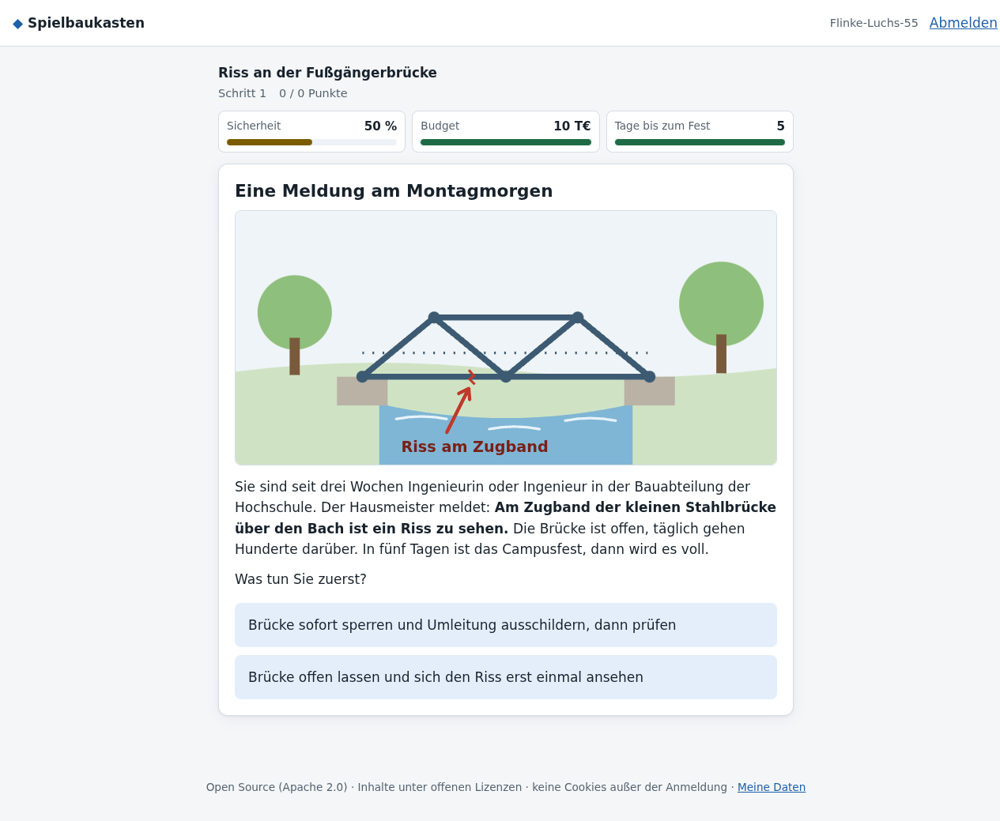

# Spielbaukasten (Teaser-Prototyp)

Ein Baukasten für **Serious Games in der ingenieurwissenschaftlichen Lehre**: Lehrende beschreiben Lernszenarien
als Datei (Szenen, Entscheidungen, Rechenaufgaben mit eigenen Zahlen je Person, Rückmeldungen), Studierende spielen
sie im Browser auf Telefon, Tablet oder Rechner. Der Fortschritt wird gespeichert, ohne Namen; Lehrende sehen, wo
ihre Gruppe hängt. Jedes Szenario lässt sich als **Open Educational Resource** exportieren: eine einzige HTML-Datei,
die ohne Server läuft.

Das ist ein Prototyp, gebaut in wenigen Tagen, um zu zeigen, wie ein solches Framework aufgebaut sein kann. Er ist
lauffähig und getestet (Messprotokoll in [`nachweis/PROTOKOLL.md`](nachweis/PROTOKOLL.md)), aber kein fertiges
Produkt. Lizenz: Apache 2.0 für den Code, CC BY 4.0 für die beiden Beispielszenarien.



## In fünf Minuten ausprobieren

Voraussetzung: [Docker Desktop](https://www.docker.com/products/docker-desktop/) (Windows, macOS) oder Docker unter
Linux.

```bash
git clone https://github.com/panoherbe/spielbaukasten.git
cd spielbaukasten
docker compose up -d
```

Dann im Browser:

| | Adresse | Zugang |
|---|---|---|
| Studierende | http://localhost:8080 | Kurscode **DEMO** |
| Lehrende | http://localhost:8080/lehrende | Schlüssel **demo-lehrende** |

Beenden: `docker compose down` (die Daten bleiben im Volume `daten`; `docker compose down -v` löscht sie).

Ohne Docker, mit [Node.js 24](https://nodejs.org/) oder neuer: `npm start` (es gibt keine Abhängigkeiten zu
installieren). Den Schlüssel für Lehrende zeigt dann die Konsole; den Demokurs gibt es mit
`SBK_DEMO_KURSCODE=DEMO npm start`.

**Was Sie sehen sollten:** Mit dem Kurscode DEMO zwei Lernspiele. „Riss an der Fußgängerbrücke“ (ca. 20 Minuten)
ist ein Entscheidungsspiel zur Technischen Mechanik: sperren oder nicht, Prüfschritte ordnen, Stabkräfte und Spannung
am Riss rechnen (jede Person bekommt andere Zahlen), dann über die Freigabe entscheiden. „Spannungsteiler am
Sensor“ (ca. 8 Minuten) ist eine kurze Übung. Unter `/lehrende` erscheinen Auswertungen ab drei Personen.

## Was der Prototyp kann

**Für Studierende**
- Beitritt mit Kurscode, ohne Konto, ohne Namen: Jede Person bekommt ein zufälliges Pseudonym und einen
  persönlichen Code, um auf einem anderen Gerät weiterzumachen.
- Szenen mit Entscheidungen, die Indikatoren verändern (im Beispiel Sicherheit, Budget, Tage); Verzweigungen nach
  Ergebnis.
- Aufgaben in drei Mechaniken: **Rechenaufgabe** mit Einheit und Toleranz (Komma oder Punkt), **Auswahl** (eine oder
  mehrere), **Reihenfolge**. Zahlen je Person verschieden, aus einem Startwert reproduzierbar.
- Rückmeldung zu **typischen Fehlern** (Vorzeichen, Faktor 1000, vom Szenario genannte Fehlerformeln wie „Sinus und
  Kosinus vertauscht“), zweiter Versuch, Hinweis gegen Punktabzug, danach Lösung mit Rechenweg.
- Ende mit Ergebnis, Punkten und dem Stand je Lernziel (sicher, mit Hilfe, noch offen).
- Fortsetzen nach Unterbrechung, auch in einem anderen Tab; eigene Daten herunterladen oder sofort löschen.

**Für Lehrende**
- Kurse anlegen (Kurscode), Szenarien je Kurs freigeben.
- Szenario-Dateien prüfen und hochladen: Fehler kommen als deutsche Meldung mit Fundstelle
  (`knoten.diagonale.loesung: „alpha“ ist kein Parameter des Szenarios`). Jede Version bleibt erhalten; laufende
  Versuche bleiben bei ihrer Version.
- Auswertung je Szenario und Kurs: Versuche, Ergebnisse, je Aufgabe Anteil „im ersten Versuch richtig“ und die
  häufigsten Fehlerarten, je Entscheidung die Verteilung. Nur Summen, und erst ab drei Personen.
- Export als **xAPI-Statements** (für Learning Record Stores) und als **OER-Paket** (eigenständige HTML-Datei plus
  Metadaten nach dem Allgemeinen Metadatenprofil für Bildungsressourcen, AMB).

**Technik**
- Node.js 24, **keine Fremdbibliotheken** zur Laufzeit; SQLite aus Node.js (`node:sqlite`). Oberfläche ohne Framework
  und ohne Build-Schritt.
- Dieselbe Spiel-Engine im Browser (Offline-Fassung) und auf dem Server. Online bewertet nur der Server: Er bekommt
  Entscheidungen und Antworten, rechnet den Zustand aus allen Schritten neu aus und schickt nur die aktuelle Ansicht
  zurück. Lösungen und Formeln verlassen den Server nicht.
- Szenarien sind Daten, kein Code: Formeln werden von einem eigenen, abgeschlossenen Rechner ausgewertet, Texte nie als
  HTML eingefügt.
- Schnittstelle beschrieben in [`docs/openapi.json`](docs/openapi.json).

## Aufbau

```
src/engine/      Spiel-Engine: Formeln, Zufall, Mechaniken, Prüfung, Ablauf, Ansicht, xAPI, OER-Metadaten
src/server/      HTTP-Server, Datenbank, Anmeldung, Szenario-Verwaltung
src/web/         Oberfläche für Studierende und Lehrende, Spieler, Darstellung der Mechaniken
src/oer-export.js  Offline-Fassung als eine HTML-Datei
inhalte/szenarien/ die Beispielszenarien (JSON + Bilder)
tools/           pruefe.js (Szenario prüfen), oer-export.js (Export auf der Kommandozeile)
test/            Unit- und Schnittstellentests, Lasttest, Browsertest (CDP)
docs/            Architektur, Inhaltsformat, Erweitern, Datenschutz, Lerndesign, Schnittstelle
nachweis/        Messprotokoll mit Bildschirmfotos
```

Mehr: [Architektur](docs/ARCHITEKTUR.md) · [Szenarien schreiben](docs/INHALTE.md) ·
[Neue Mechanik ergänzen](docs/ERWEITERN.md) · [Datenschutz](docs/DATENSCHUTZ.md) · [Lerndesign und Evaluation des
Beispielszenarios](docs/LERNDESIGN.md)

## Tests

```bash
docker compose run --rm test                          # 32 Unit- und Schnittstellentests, unter 1 s
node tools/pruefe.js inhalte/szenarien/*/szenario.json  # Szenarien prüfen
```

Die Nachweis-Messung (Last mit 50 und 200 gleichzeitigen Personen, Durchspielen im echten Chrome auf Desktop- und
Telefonbreite, Barrierefreiheit mit axe-core, Offline-Fassung):

```bash
docker compose -p spielbaukasten-nachweis -f compose.nachweis.yaml up --build --abort-on-container-exit --exit-code-from messung
docker compose -p spielbaukasten-nachweis -f compose.nachweis.yaml down -v
```

## Einstellungen

| Variable | Bedeutung | Vorgabe |
|---|---|---|
| `SBK_LEHRENDE_SCHLUESSEL` | Schlüssel für die Anmeldung als Lehrende | zufällig je Start (Konsole) |
| `SBK_DEMO_KURSCODE` | legt beim Start einen Demokurs mit allen Szenarien an | keiner |
| `SBK_AUFBEWAHRUNG_TAGE` | danach werden Versuche und Pseudonyme ohne Nutzung gelöscht | 180 |
| `SBK_MIN_GRUPPE` | Auswertungen erst ab so vielen Personen | 3 |
| `SBK_BASIS_URL` | öffentliche Adresse (für xAPI und OER-Metadaten) | `http://localhost:8080` |
| `SBK_SICHERE_COOKIES` | `1` hinter HTTPS | aus |
| `SBK_ZUGRIFFSPROTOKOLL` | `1` schreibt Methode, Pfad, Status, Dauer (keine IP-Adressen) | aus |
| `SBK_DATEN`, `SBK_INHALTE`, `PORT` | Datenverzeichnis, Szenario-Verzeichnis, Port | `./daten`, `./inhalte/szenarien`, 8080 |

## Grenzen des Prototyps

- Anmeldung für Lehrende mit einem gemeinsamen Schlüssel je Instanz; eine Anbindung an das Single Sign-on einer
  Hochschule (Shibboleth/SAML oder OpenID Connect) ist nicht enthalten.
- Keine Moodle-Anbindung. Vorbereitet sind die xAPI-Ausgabe und eine dokumentierte Schnittstelle; LTI 1.3 wäre der
  nächste Schritt.
- Szenarien werden als JSON-Datei geschrieben; einen grafischen Editor gibt es nicht.
- SQLite genügt für eine Instanz mit einigen hundert gleichzeitigen Personen (gemessen: 200, siehe Protokoll); für
  mehr wäre PostgreSQL vorgesehen (Datenzugriff in `src/server/db.js` gekapselt).
- Gestaltung bewusst schlicht und anpassbar über Variablen in `src/web/styles.css`; kein Corporate Design einer
  Hochschule.
- Die Fachinhalte der Beispielszenarien sind Lehrbeispiele (vereinfachtes Lehrmodell, kein vollständiger Nachweis
  nach Eurocode 3) und nicht von Fachlehrenden geprüft.
