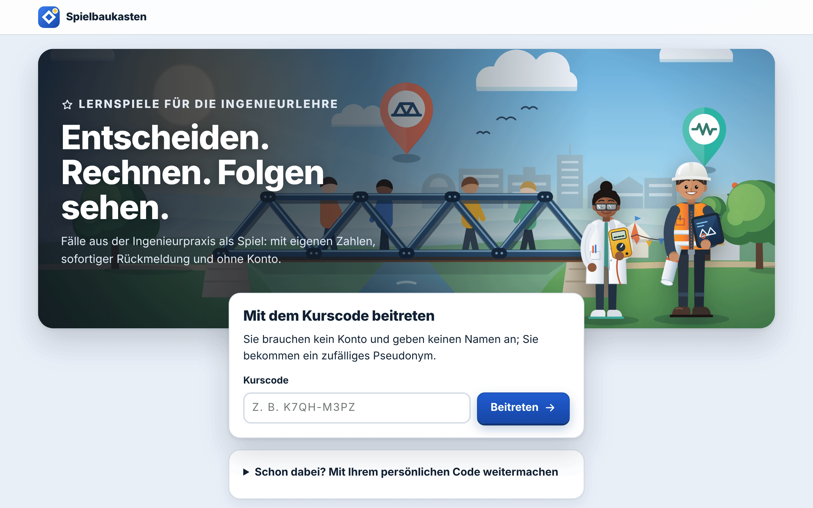
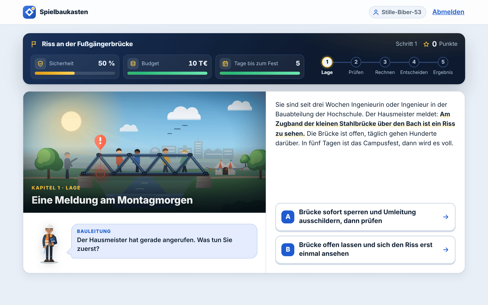
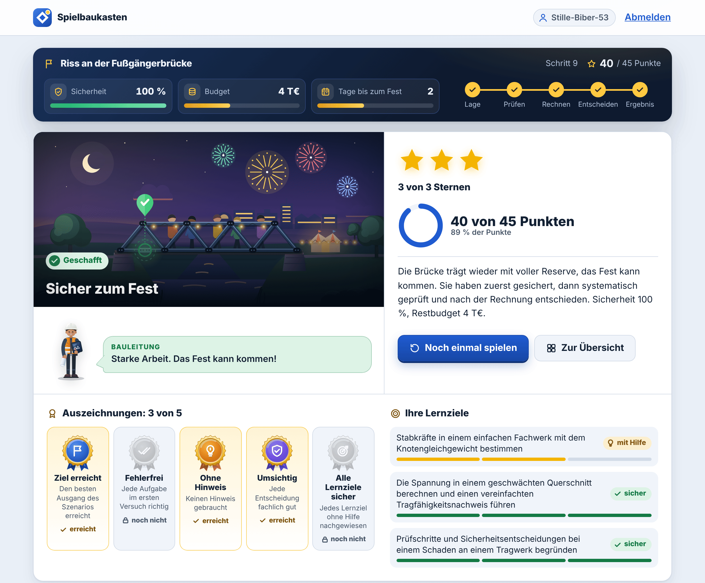
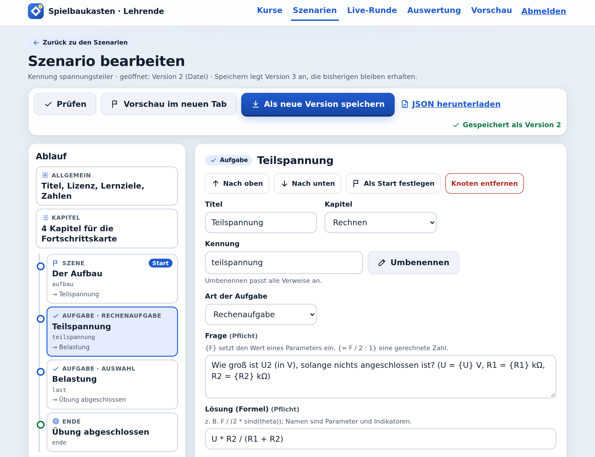
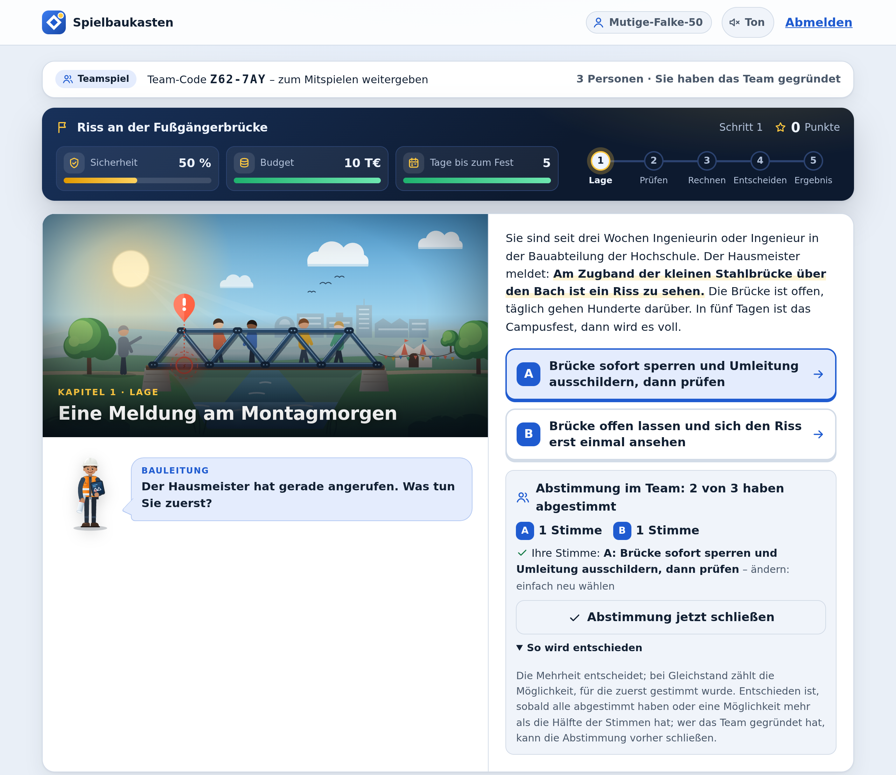
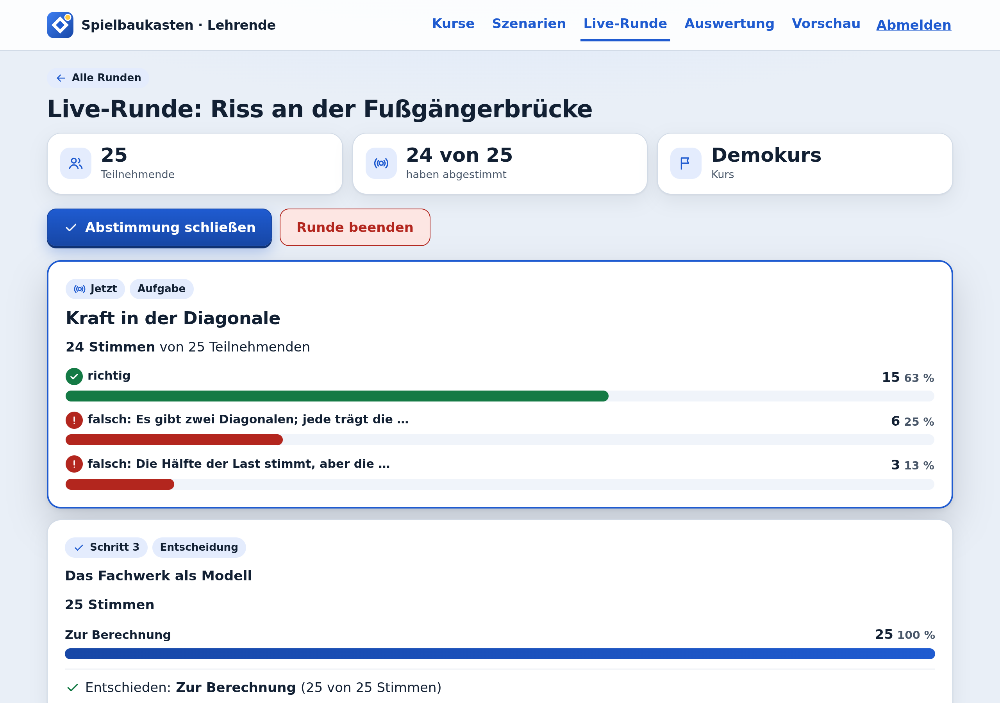
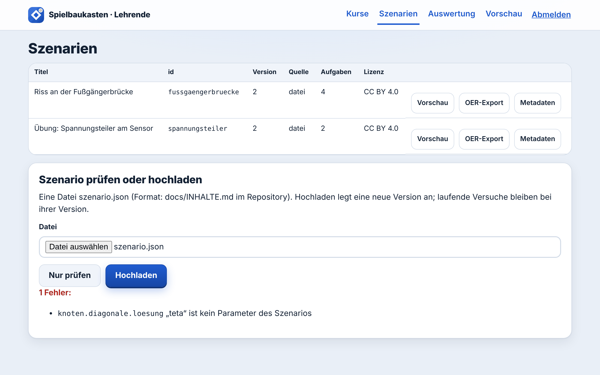

# Spielbaukasten

**Lernspiele für die Ingenieurlehre: Studierende spielen im Browser, allein, im Team oder mit dem ganzen Kurs;
Lehrende bauen neue Spiele im Editor, ohne zu programmieren, und sehen, wo die Gruppe hängt. Das läuft heute –
ansehen, selbst ausprobieren, nachprüfen.**


<sub>Rundgang, 89 Sekunden, ohne Ton, mit Untertiteln; aufgenommen am 09.11.2026 an einer laufenden Installation.
[Video herunterladen (MP4, 2,6 MB)](https://github.com/panoherbe/spielbaukasten/raw/main/medien/rundgang.mp4) · Text des Rundgangs weiter unten.
Editor, Teamspiel, Live-Runde, Administration und Ton sind danach dazugekommen (12.11.2026); sie zeigen die Bilder
weiter unten.</sub>

## Was Sie brauchen → läuft hier schon

| Was Sie brauchen | läuft hier schon |
|---|---|
| Lernspiele im Browser, auf dem Telefon wie am Rechner | zwei Beispielspiele (Technische Mechanik, Elektrotechnik) mit Szenenbildern, Spielfigur mit Sprechblase, Spielanzeige, Kapitelkarte, Sternen und Auszeichnungen; das Brückenspiel in Chromium auf Rechner- und Telefonbreite und im dunklen Schema durchgespielt (12.11.2026) |
| Neue Spiele ohne Programmierung | **Szenario-Editor** im Browser: links der Ablauf aller Szenen und Aufgaben, rechts Formulare für Texte, Entscheidungen, Rechenaufgaben mit Einheit und Toleranz, Rückmeldungen und Verzweigungen; „Prüfen“ zeigt Fehler auf Deutsch, „Zur Stelle“ springt ins Feld; „Vorschau im neuen Tab“; jede Speicherung ist eine neue Version, die alte bleibt (im Browser durchgespielt, 12.11.2026) |
| Gemeinsam spielen | **Teamspiel**: ein Spielstand für das ganze Team, jede Person stimmt ab, die Mehrheit entscheidet. **Live-Runde** für den ganzen Kurs: alle stimmen auf dem eigenen Gerät ab, Lehrende sehen live die Verteilung je Schritt und schließen die Abstimmung. Neue Stände kommen ohne Neuladen, bei allen in unter 0,02 s (Lasttest, 12.11.2026) |
| Entscheidungen mit Folgen | jede Entscheidung verändert sichtbar Sicherheit, Budget und Tage bis zum Fest; eine fachliche Bewertung und die Spielfigur erklären, warum |
| Rückmeldung, die beim Lernen hilft | typische Fehler werden erkannt und erklärt; zweiter Versuch, Hinweis, Lösung mit Rechenweg; auf Wunsch kurze **Töne** für richtig, falsch, Entscheidung und neue Szene (im Browser erzeugt, keine Tondateien; aus, bis man sie einschaltet; nie das einzige Signal) |
| Lernfortschritt und Auswertung für Lehrende | Stand je Lernziel; Diagramme: Ausgang der Versuche, je Aufgabe der Anteil „im ersten Versuch richtig“, die häufigsten Fehler, die Verteilung der Entscheidungen |
| Datenschutz | keine Namen, keine E-Mail-Adressen, zufällige Pseudonyme; Auswertung und Live-Runde zeigen nur Summen, erst ab 3 Personen; Löschen auf Knopfdruck |
| Rollen und Verwaltung | drei Rollen: Studierende, Lehrende, **Administration**; persönliche Zugänge für Lehrende, sperren (sofort abgemeldet) und entsperren; Aufbewahrungsfrist in der Oberfläche; Protokoll der Verwaltung |
| Offene Lernressourcen (OER) | Export als eine einzige HTML-Datei (339 KB mit allen Bildern), läuft ohne Server und ohne Internet: 0 Netzanfragen (12.11.2026); Metadaten nach dem Profil AMB |
| Viele Studierende | Lasttest mit simulierten Studierenden (12.11.2026), 0 Fehler: 300 mit Denkzeit, 95 % der Antworten unter 0,10 s; 200 im selben Augenblick; 50 Teams zu je drei; eine Live-Runde mit 200, neuer Stand bei allen 200 in höchstens 0,018 s |
| Barrierefreiheit | automatische Prüfung mit axe-core (WCAG 2.0/2.1 A und AA, WCAG 2.2 AA): 0 Verstöße in 47 Zuständen, mit Editor, Teamspiel, Live-Runde und Administration, auch auf dem Telefon und im dunklen Schema (12.11.2026); Farbe trägt nie allein Bedeutung; Bewegung lässt sich abschalten |
| Schlank und sicher | erste Seite 16 Dateien, 42 KB übertragen, keine Dateien von fremden Servern (12.11.2026); im Online-Spiel erhalten Studierende weder Lösungen noch Formeln |
| Geprüfte Qualität | 62 von 62 automatischen Tests bestanden (12.11.2026) |
| Anschluss an Lernplattformen | xAPI-Ausgabe und eine dokumentierte Schnittstelle (OpenAPI) |
| Offen und übergabefähig | Quellcode unter AGPL-3.0, keine Fremdbibliotheken zur Laufzeit, Dokumentation auf Deutsch |

Jede Zahl steht mit Messweg im [Messprotokoll vom 12.11.2026](nachweis/PROTOKOLL.md) (Version 0.2.0; Rohdaten
`nachweis/messwerte.json`).

## In zwei Minuten selbst prüfen

1. **Ohne Installation spielen:** die [Offline-Fassung](demo/fussgaengerbruecke-v2.html) öffnen, rechts über dem
   Quelltext auf „Download raw file“ (Pfeil nach unten) klicken, die Datei (339 KB) per Doppelklick im Browser öffnen.
   Das Brückenspiel läuft vollständig, ohne Server und ohne Internet; der Fortschritt bleibt auf Ihrem Gerät.
   (Gemessen in Chrome.)
2. **Die ganze Anwendung starten** – mit [Docker Desktop](https://www.docker.com/products/docker-desktop/), drei
   Befehle:
   ```bash
   git clone https://github.com/panoherbe/spielbaukasten.git
   cd spielbaukasten
   docker compose up -d
   ```
   Dann http://localhost:8080 öffnen, Kurscode **DEMO**. Bereich für Lehrende mit Editor und Live-Runde:
   http://localhost:8080/lehrende, Schlüssel **demo-lehrende**. Administration: http://localhost:8080/admin,
   Schlüssel **demo-admin**. Für ein Teamspiel die Startseite zusätzlich in einem privaten Fenster öffnen (für eine dritte Person einen anderen Browser); private Fenster desselben Browsers teilen sich die Anmeldung.
3. **Nachlesen, was gemessen wurde:** [Messprotokoll](nachweis/PROTOKOLL.md) mit 44 Bildschirmfotos.

## Was Sie heute schon prüfen können

- Oberfläche, Spielablauf, Auswertung und Export lassen sich heute ausprobieren.
- Last (im Lasttest mit simulierten Studierenden, allein, im Team und in der Live-Runde), Barrierefreiheit
  (automatisch geprüft), Datenschutz und Offline-Export sind gebaut und gemessen.
- Die Projektzeit geht in Ihre Anforderungen, Ihre Inhalte und Tests mit Studierenden und Lehrenden; ein erster
  testbarer Stand steht früh.
- Offener Quellcode (AGPL-3.0), keine Fremdbibliotheken zur Laufzeit, Dokumentation auf Deutsch: Das Framework lässt
  sich ohne mich betreiben und weiterentwickeln.

## So sieht es aus

<table>
<tr>
<td width="50%" valign="top"><br><sub>Start: Beitritt mit Kurscode, ohne Konto und ohne Namen.</sub></td>
<td width="50%" valign="top"><br><sub>Eine Szene: Spielanzeige, Kapitelkarte, Szenenbild, Bauleitung mit Sprechblase, Entscheidungen als Karten.</sub></td>
</tr>
<tr>
<td valign="top"><br><sub>Rechenaufgabe mit eigenen Zahlen: Ein typischer Fehler wird erkannt und erklärt.</sub></td>
<td valign="top"><br><sub>Ergebnis: Sterne, Punkte, Auszeichnungen und der Stand je Lernziel.</sub></td>
</tr>
<tr>
<td colspan="2" valign="top"><br><sub>Szenario-Editor: links der Ablauf, rechts das Formular. Prüfen, Vorschau, Speichern als neue Version.</sub></td>
</tr>
<tr>
<td valign="top"><br><sub>Teamspiel: ein Spielstand, jede Person stimmt ab, die Mehrheit entscheidet.</sub></td>
<td valign="top"><br><sub>Live-Runde: Die Lehrperson sieht, wie der Kurs antwortet, nur Summen ab drei Stimmen. Alle Stimmen im Bild sind simuliert (24 über die Schnittstelle, eine über einen automatisch gesteuerten Browser).</sub></td>
</tr>
<tr>
<td valign="top" align="center"><br><sub>Auf dem Telefon: dasselbe Spiel im Browser, ohne App.</sub></td>
<td valign="top"><br><sub>Auswertung für Lehrende mit Diagrammen; nur Summen, erst ab drei Personen. Zahlen aus einem Lasttest mit 200 simulierten Studierenden, dazu drei Testdurchläufe.</sub><br><br><br><sub>Hinter dem Editor steht eine Datei: Wer lieber mit Dateien arbeitet, lädt sie hoch; die Prüfung meldet einen Tippfehler mit Fundstelle.</sub></td>
</tr>
</table>

<details>
<summary><b>Text des Rundgangs</b> (die Untertitel des Videos vom 09.11.2026, mit den damaligen Messwerten aus dem [Protokoll vom 09.11.2026](https://github.com/panoherbe/spielbaukasten/blob/edbc7f3/nachweis/PROTOKOLL.md))</summary>

| ab | Untertitel |
|---|---|
| 0:00 | Ein Riss an der Fußgängerbrücke, in fünf Tagen ist Campusfest. **Was tun Sie zuerst?** |
| 0:03 | Jede Entscheidung hat Folgen: **Sicherheit +20 %**, die Bauleitung ist zufrieden. |
| 0:08 | **Titel:** Spielbaukasten – Lernspiele für die Ingenieurlehre. Studierende entscheiden, rechnen und sehen die Folgen. Lehrende sehen, wo die Gruppe hängt. Neue Spiele entstehen als Datei. |
| 0:11 | Studierende treten mit dem Kurscode bei: ohne Konto, ohne Namen. |
| 0:14 | Jede Person spielt unter einem zufälligen Pseudonym. |
| 0:17 | Zwei Lernspiele zum Ausprobieren: Technische Mechanik und Elektrotechnik. |
| 0:19 | Prüfschritte ordnen: Karten nach oben oder unten schieben. |
| 0:26 | Unterlagen, Befund, Rechnung, Nachweis, Maßnahme. |
| 0:29 | Das Fachwerk als Modell. Jede Person bekommt eigene Zahlen. |
| 0:32 | Rechnen mit eigenen Zahlen. Wir tippen absichtlich einen typischen Fehler … |
| 0:35 | … das System erkennt ihn und erklärt: Die Last teilt sich auf zwei Diagonalen. |
| 0:39 | Zweiter Versuch. |
| 0:40 | Richtig, mit Rechenweg zum Nachlesen. Punkte und Kapitelkarte laufen mit. |
| 0:43 | Die Aufgaben bauen aufeinander auf: Kraft im Zugband, dann die Spannung am Riss. |
| 0:46 | Die Rechnung ist fertig. Wie entscheiden Sie: freigeben oder reparieren? |
| 0:51 | Am Ende: Sterne, Punkte und das Fest kann kommen. |
| 0:54 | Auszeichnungen und der Stand je Lernziel: sicher, mit Hilfe oder noch offen. |
| 0:58 | **Sensor-Übung: Auch auf dem Telefon.** Im Browser, ohne App und ohne Installation. Mit Laborleitung statt Bauleitung. Rechnen mit eigenen Zahlen, auch auf dem kleinen Bildschirm. Keine Dateien von fremden Servern. |
| 1:03 | Lehrende sehen, wo die Gruppe hängt. Nur Summen, erst ab drei Personen. |
| 1:06 | Entscheidungen mit Bewertung. Zahlen: 200 simulierte Studierende. |
| 1:10 | Neue Spiele sind Dateien. Hier eine mit einem Tippfehler in einer Formel … |
| 1:12 | … die Prüfung findet ihn und nennt die Stelle, auf Deutsch. |
| 1:15 | Jedes Spiel auch als offene Lernressource: eine HTML-Datei, ohne Server und ohne Internet. |
| 1:19 | **Gemessen am 09.11.2026:** 42 von 42 automatischen Tests bestanden · Lasttest mit 300 simulierten Studierenden: 0 Fehler, 95 % der Antworten unter 0,16 s · Barrierefreiheit automatisch geprüft (axe-core, WCAG 2.2 AA): 0 Verstöße in 22 Zuständen · erste Seite 37 KB, keine Dateien von fremden Servern · Offline-Fassung als eine Datei: 0 Netzanfragen. |
| 1:25 | **Selbst prüfen:** github.com/panoherbe/spielbaukasten – Offline-Fassung herunterladen und im Browser öffnen, oder die ganze Anwendung mit drei Befehlen starten. Quellcode offen, AGPL-3.0. |

</details>

## Eigenes Lernspiel in vier Schritten

1. **Im Editor öffnen:** unter `/lehrende` → Szenarien ein Spiel „Bearbeiten“ oder ein neues anlegen.
2. **Ändern:** links im Ablauf eine Szene oder Aufgabe wählen, rechts Texte, Entscheidungen, Lösung, Einheit,
   Toleranz und Rückmeldungen eintragen; Knoten hinzufügen, verschieben, verbinden.
3. **Prüfen, Vorschau, speichern:** „Prüfen“ zeigt Fehler mit „Zur Stelle“, „Vorschau im neuen Tab“ spielt den
   Entwurf, „Als neue Version speichern“ behält die alte Version.
4. **Freigeben und spielen:** unter Kurse freigeben, Kurscode weitergeben; allein, im Team oder als Live-Runde in der
   Vorlesung; die Auswertung zeigt Zahlen ab drei Personen.

Mit Bildern Schritt für Schritt: [Anleitung für Lehrende](docs/ANLEITUNG-LEHRENDE.md).

## Was der Prototyp noch nicht ist

Ein Prototyp, in wenigen Tagen gebaut, um zu zeigen, dass die Architektur trägt. Kein fertiges Produkt.

| Heute noch nicht enthalten | Was ein Auftrag ergänzen würde |
|---|---|
| Anmeldung über das Single Sign-on einer Hochschule (Shibboleth/SAML, OpenID Connect); heute Schlüssel: ein gemeinsamer je Installation und persönliche Zugänge, die die Administration vergibt | Anbindung an Ihr Anmeldesystem |
| Anbindung an Moodle; vorbereitet sind die xAPI-Ausgabe und die dokumentierte Schnittstelle | Anbindung an Ihre Lernplattform, etwa über LTI 1.3 |
| Bilder im Editor hochladen; heute wählt der Editor aus den Bildern im Ordner des Szenarios | Hochladen mit Pflichtfeld für die Lizenz, weitere Werkzeuge für Autorinnen und Autoren nach Ihren Anforderungen |
| Feinere Rechte; heute sehen alle Zugänge für Lehrende alle Kurse | Kurse und Szenarien je Zugang, Rechte je Kurs |
| Fachlich geprüfte Inhalte; die Beispiele sind vereinfachte Lehrmodelle, nicht von Fachlehrenden geprüft | Ihre Inhalte und Lernziele, mit Ihren Lehrenden |
| Ihr Erscheinungsbild; Grafiken, Figuren und Farben sind die Beispiele dieses Prototyps | Gestaltung nach Ihren Vorgaben, über die Design-Tokens und eigene Grafiken |
| Nicht gemessen: echte Geräte, Safari und Firefox, Bildschirmleser, Nutzung durch Studierende (auch keine echten Teams oder Live-Runden), ob die Töne hörbar und angenehm sind, Dauerbetrieb hinter HTTPS | Usability-Tests mit Studierenden und Lehrenden, Erprobung im Semester, Abnahmetest |

## Lizenz

Code: ab 04.11.2026 AGPL-3.0; frühere Stände bis Commit [`414f6d6`](https://github.com/panoherbe/spielbaukasten/tree/414f6d6) bleiben unter Apache-2.0. Die beiden Beispielszenarien und die Grafiken: CC BY 4.0 (Panagiotis Herbe). Auftraggeber erhalten im Auftrag die vertraglich vereinbarte Lizenz.

## Kontakt

Panagiotis Herbe · [panoherbe.com](https://panoherbe.com)

---

## Für Ihre IT: Technik im Detail

### Starten

Voraussetzung: [Docker Desktop](https://www.docker.com/products/docker-desktop/) (Windows, macOS) oder Docker unter
Linux.

```bash
git clone https://github.com/panoherbe/spielbaukasten.git
cd spielbaukasten
docker compose up -d
```

| | Adresse | Zugang |
|---|---|---|
| Studierende | http://localhost:8080 | Kurscode **DEMO** |
| Lehrende | http://localhost:8080/lehrende | Schlüssel **demo-lehrende** |
| Administration | http://localhost:8080/admin | Schlüssel **demo-admin** |

Beenden: `docker compose down` (die Daten bleiben im Volume `daten`; `docker compose down -v` löscht sie).

Ohne Docker, mit [Node.js 24](https://nodejs.org/) oder neuer: `npm start` (es gibt keine Abhängigkeiten zu
installieren). Die Schlüssel für Lehrende und Administration zeigt dann die Konsole; den Demokurs gibt es mit
`SBK_DEMO_KURSCODE=DEMO npm start`.

**Was Sie sehen sollten:** Mit dem Kurscode DEMO zwei Lernspiele. „Riss an der Fußgängerbrücke“ (ca. 20 Minuten)
ist ein Entscheidungsspiel zur Technischen Mechanik: sperren oder nicht, Prüfschritte ordnen, Stabkräfte und Spannung
am Riss rechnen (jede Person bekommt eigene Zahlen), dann über die Freigabe entscheiden. „Spannungsteiler am
Sensor“ (ca. 8 Minuten) ist eine kurze Übung. Unter `/lehrende` erscheinen Auswertungen ab drei Personen; dort
öffnet „Bearbeiten“ den Editor und „Live-Runde“ startet eine Runde für einen Kurs.

### Funktionen

**Für Studierende**
- Beitritt mit Kurscode, ohne Konto, ohne Namen: Jede Person bekommt ein zufälliges Pseudonym und einen
  persönlichen Code, um auf einem anderen Gerät weiterzumachen.
- Spielbühne: großes Szenenbild, Spielfigur mit Sprechblase (Bauleitung, Laborleitung), Spielanzeige mit Symbolen
  und animierten Änderungen, Kapitelkarte. Helles und dunkles Schema; mit „Bewegung reduzieren“ stehen alle
  Animationen still.
- Szenen mit Entscheidungen, die Indikatoren verändern (im Beispiel Sicherheit, Budget, Tage); Verzweigungen nach
  Ergebnis.
- Aufgaben in drei Mechaniken: **Rechenaufgabe** mit Einheit und Toleranz (Komma oder Punkt), **Auswahl** (eine oder
  mehrere), **Reihenfolge**. Zahlen je Person verschieden, aus einem Startwert reproduzierbar.
- Rückmeldung zu **typischen Fehlern** (Vorzeichen, Faktor 1000, vom Szenario genannte Fehlerformeln wie „Sinus und
  Kosinus vertauscht“), zweiter Versuch, Hinweis gegen Punktabzug, danach Lösung mit Rechenweg.
- Rückmeldung als großes Zeichen (Haken mit Funken, Waage, Ausrufezeichen), immer mit Text; die Figur freut sich
  oder sorgt sich.
- Ende mit Ergebnis, 0 bis 3 Sternen, Punkten, fünf Auszeichnungen und dem Stand je Lernziel (sicher, mit Hilfe,
  noch offen).
- Fortsetzen nach Unterbrechung, auch in einem anderen Tab; eigene Daten herunterladen oder sofort löschen.
- **Im Team spielen:** ein Team gründen oder mit dem Team-Code beitreten (nur im eigenen Kurs). Alle sehen dieselbe
  Szene mit denselben Zahlen, jede Person stimmt ab, sieht die Stimmen je Möglichkeit und kann ihre Stimme ändern.
  Regel: Die Mehrheit entscheidet, bei Gleichstand die Möglichkeit, für die zuerst gestimmt wurde; entschieden ist,
  sobald alle abgestimmt haben oder eine Möglichkeit mehr als die Hälfte hat; wer das Team gegründet hat, kann vorher
  schließen. Antworten auf Rechenaufgaben zählen als gleich, wenn sie gleich bewertet werden.
- **Live-Runde:** Läuft eine Runde im eigenen Kurs, steht sie auf der Übersicht („Mitmachen“).
- **Ton:** Schalter „Ton“ in der Kopfzeile; aus, bis man ihn einschaltet; die Einstellung bleibt beim Pseudonym.

**Für Lehrende**
- Kurse anlegen (Kurscode), Szenarien je Kurs freigeben.
- **Szenario-Editor:** Ablauf aller Knoten mit ihren Wegen; Formulare für allgemeine Angaben (Titel, Lizenz,
  Lernziele, Indikatoren, Zahlen je Person, Titelbild), Kapitel und jeden Knoten (Szene mit Entscheidungen,
  Bewertung, Rückmeldung und Wirkung; Aufgabe als Rechenaufgabe mit Formel, Einheit, Toleranz und typischen Fehlern,
  als Auswahl oder Reihenfolge; Verzweigung mit Regeln; Ende). Knoten hinzufügen, verschieben, umbenennen (Verweise
  werden angepasst), entfernen. „Prüfen“ mit „Zur Stelle“, „Vorschau im neuen Tab“ ohne Speichern, „Als neue Version
  speichern“ (die alte bleibt; wer inzwischen gespeichert hat, wird nicht überschrieben). Fortgeschritten: JSON
  ansehen und bearbeiten, herunterladen.
- **Live-Runde:** für einen Kurs starten, live sehen, wie viele abgestimmt haben und, ab drei Stimmen, die Verteilung
  je Schritt (Entscheidungen mit Bewertung, Aufgaben als „richtig“ und erkannte Fehler), Abstimmung schließen, Runde
  beenden.
- Szenario-Dateien prüfen und hochladen: Fehler kommen als deutsche Meldung mit Fundstelle
  (`knoten.diagonale.loesung „alpha“ ist kein Parameter des Szenarios`). Jede Version bleibt erhalten; laufende
  Versuche bleiben bei ihrer Version.
- Auswertung je Szenario und Kurs, als Diagramme und als Tabelle: Versuche, Ausgang, je Aufgabe Anteil „im ersten
  Versuch richtig“ und die häufigsten Fehlerarten, je Entscheidung die Verteilung mit fachlicher Bewertung. Nur
  Summen, und erst ab drei Personen.
- Export als **xAPI-Statements** (für Learning Record Stores) und als **OER-Paket** (eigenständige HTML-Datei plus
  Metadaten nach dem Allgemeinen Metadatenprofil für Bildungsressourcen, AMB). Beispiel: [`demo/`](demo/).

**Für die Administration**
- Zugänge für Lehrende anlegen (der Schlüssel erscheint einmal), sperren (sofort abgemeldet, Anmeldung abgewiesen),
  entsperren; auch der gemeinsame Schlüssel der Instanz ist ein Zugang.
- Aufbewahrungsfrist in der Oberfläche (7 bis 3650 Tage, gilt sofort); Einstellungen der Instanz ansehen.
- Protokoll der Verwaltung: Anmeldungen, Zugänge, Kurse, Freigaben, gespeicherte Szenarien, Live-Runden, Exporte;
  nie Spielschritte von Studierenden, keine IP-Adressen. Die Administration sieht keine Spielstände.

**Technik**
- Node.js 24, **keine Fremdbibliotheken** zur Laufzeit; SQLite aus Node.js (`node:sqlite`). Oberfläche ohne Framework
  und ohne Build-Schritt; alle Grafiken als SVG-Dateien im Repository. Text und SVG gehen mit gzip hinaus.
- Dieselbe Spiel-Engine im Browser (Offline-Fassung) und auf dem Server. Online bewertet nur der Server: Er bekommt
  Entscheidungen und Antworten, rechnet den Zustand aus allen Schritten neu aus und schickt nur die aktuelle Ansicht
  zurück. Im Online-Spiel erhalten Studierende weder Lösungen noch Formeln (die Offline-Fassung und der Editor für Lehrende enthalten sie zwangsläufig).
- Szenarien sind Daten, kein Code: Formeln werden von einem eigenen, abgeschlossenen Rechner ausgewertet, Texte nie als
  HTML eingefügt.
- Teamspiel und Live-Runde: ein gemeinsamer Ereignisstrom je Gruppe, dieselbe Engine; neue Stände über Server-Sent
  Events (im Browser enthalten, keine Bibliothek). Das Einzelspiel bleibt davon unberührt.
- Töne mit der Web Audio API erzeugt, keine Tondateien.
- Schnittstelle beschrieben in [`docs/openapi.json`](docs/openapi.json).

### Aufbau

```
src/engine/      Spiel-Engine: Formeln, Zufall, Mechaniken, Prüfung, Ablauf, Ansicht, xAPI, OER-Metadaten
src/server/      HTTP-Server, Datenbank, Anmeldung und Rollen, Szenario-Verwaltung, Teams und Live-Runden
src/web/         Oberfläche für Studierende, Lehrende (mit Editor und Live-Runde) und Administration, Spieler, Ton
src/oer-export.js  Offline-Fassung als eine HTML-Datei
inhalte/szenarien/ die Beispielszenarien (JSON + Bilder)
tools/           pruefe.js (Szenario prüfen), oer-export.js (Export auf der Kommandozeile)
test/            Unit- und Schnittstellentests, Lasttest (allein, Teams, Live-Runde), Browsertest (CDP)
docs/            Anleitung für Lehrende, Architektur, Inhaltsformat, Erweitern, Datenschutz, Lerndesign, Schnittstelle
nachweis/        Messprotokoll mit Bildschirmfotos
demo/            Offline-Fassung des Brückenspiels mit AMB-Metadaten (erzeugt mit tools/oer-export.js)
medien/          Rundgang (Video, GIF, Poster), Bilder für diese Seite, Grafiken als Quelle (kunst/)
```

Mehr: [Architektur](docs/ARCHITEKTUR.md) · [Anleitung für Lehrende](docs/ANLEITUNG-LEHRENDE.md) ·
[Szenarien schreiben](docs/INHALTE.md) ·
[Neue Mechanik ergänzen](docs/ERWEITERN.md) · [Datenschutz](docs/DATENSCHUTZ.md) · [Lerndesign und Evaluation des
Beispielszenarios](docs/LERNDESIGN.md)

### Tests

```bash
docker compose run --rm test                          # 62 Unit- und Schnittstellentests, unter 1 s
node tools/pruefe.js inhalte/szenarien/*/szenario.json  # Szenarien prüfen
```

Die Nachweis-Messung (Lasttest mit 50 und 200 simulierten Personen im selben Augenblick, 300 simulierten mit
Denkzeit, 50 simulierten Teams und einer Live-Runde mit 200 simulierten Personen; Durchspielen in echtem Chrome auf
Desktop- und Telefonbreite und im dunklen Schema; Editor, Teamspiel, Live-Runde, Administration und Ton im Browser;
Barrierefreiheit mit axe-core; Offline-Fassung) startet mit Docker so; ohne Docker siehe
[Messprotokoll](nachweis/PROTOKOLL.md):

```bash
docker compose -p spielbaukasten-nachweis -f compose.nachweis.yaml up --build --abort-on-container-exit --exit-code-from messung
docker compose -p spielbaukasten-nachweis -f compose.nachweis.yaml down -v
```

### Einstellungen

| Variable | Bedeutung | Vorgabe |
|---|---|---|
| `SBK_LEHRENDE_SCHLUESSEL` | gemeinsamer Schlüssel der Instanz für Lehrende (persönliche Zugänge vergibt die Administration) | zufällig je Start (Konsole); im Compose `demo-lehrende` |
| `SBK_ADMIN_SCHLUESSEL` | Schlüssel für die Administration | zufällig je Start (Konsole); im Compose `demo-admin` |
| `SBK_DEMO_KURSCODE` | legt beim Start einen Demokurs mit allen Szenarien an | keiner; im Compose `DEMO` |
| `SBK_AUFBEWAHRUNG_TAGE` | danach werden Versuche, Teams, Pseudonyme und Protokolleinträge ohne Nutzung gelöscht; die Administration kann den Wert in der Oberfläche ändern | 180 |
| `SBK_MIN_GRUPPE` | Auswertungen erst ab so vielen Personen | 3 |
| `SBK_BASIS_URL` | öffentliche Adresse (für xAPI und OER-Metadaten) | `http://localhost:8080` |
| `SBK_SICHERE_COOKIES` | `1` hinter HTTPS | aus |
| `SBK_ZUGRIFFSPROTOKOLL` | `1` schreibt Methode, Pfad, Status, Dauer (keine IP-Adressen) | aus |
| `SBK_DATEN`, `SBK_INHALTE`, `PORT` | Datenverzeichnis, Szenario-Verzeichnis, Port | `./daten`, `./inhalte/szenarien`, 8080 |

### Technische Grenzen

- SQLite genügt für die Last, die gemessen ist: im Lasttest mit simulierten Studierenden 300 mit Denkzeit, 200 im
  selben Augenblick, 50 Teams und eine Live-Runde mit 200 ohne Fehler (siehe Protokoll). Für mehr wäre PostgreSQL
  vorgesehen (Datenzugriff in `src/server/db.js` gekapselt).
- Live-Stände halten je Person eine Verbindung offen (Server-Sent Events). Ein Reverse Proxy davor darf
  `text/event-stream` nicht puffern; gemessen ist das nicht.
- Gestaltung über Design-Tokens in `src/web/styles.css` anpassbar (helles und dunkles Schema).
- Die Fachinhalte der Beispielszenarien sind Lehrbeispiele (vereinfachtes Lehrmodell, kein vollständiger Nachweis
  nach Eurocode 3).

### Rundgang und Bilder

Aufgenommen am 09.11.2026 mit Playwright (Chromium) an einer laufenden Installation dieses Repositorys (Node.js 24,
ohne Docker). 200 simulierte Studierende aus dem Lasttest (`test/last.js`, ein Teil der Entscheidungen zufällig
gestreut) füllen die Auswertung. Untertitel und Mauszeiger sind in die Seite gezeichnet; dafür ist im Aufnahmebrowser
die Content-Security-Policy abgeschaltet, die Anwendung selbst ist unverändert. Das Video hat keinen Ton. Die
Messwerte der Schlusskarte stammen aus dem [Protokoll vom 09.11.2026](https://github.com/panoherbe/spielbaukasten/blob/edbc7f3/nachweis/PROTOKOLL.md), nicht aus der Aufnahme. Zwei Stellen sind
nachträglich ersetzt (09.11.2026): Bei 1:10 zeigte der Aufnahmebrowser den Dateiknopf englisch („Choose File“); das Feld
ist durch dieselbe Ansicht in einem deutschen Chromium ersetzt („Datei auswählen“). Die Karte bei 0:58 hieß „Dasselbe
Spiel auf dem Telefon“, zeigt aber die Sensor-Übung; sie heißt jetzt „Auch auf dem Telefon“. Die übrigen Bilder auf
dieser Seite sind am selben Tag mit Playwright entstanden, bis auf Editor, Teamspiel und Live-Runde: Diese drei
stammen aus der Nachweis-Messung vom 12.11.2026 (Chromium headless über das DevTools-Protokoll, 1280 px breit); die
Alle Stimmen im Bild der Live-Runde sind simuliert: 24 über die Schnittstelle, eine über einen automatisch gesteuerten Browser.

Lizenz: AGPL-3.0 für den Code (bis Commit `414f6d6` Apache-2.0), CC BY 4.0 für die beiden Beispielszenarien und
die Grafiken (Panagiotis Herbe).
