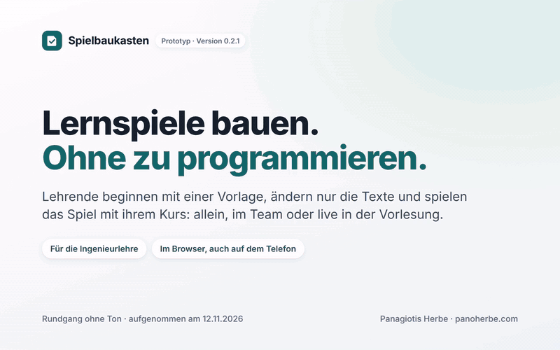
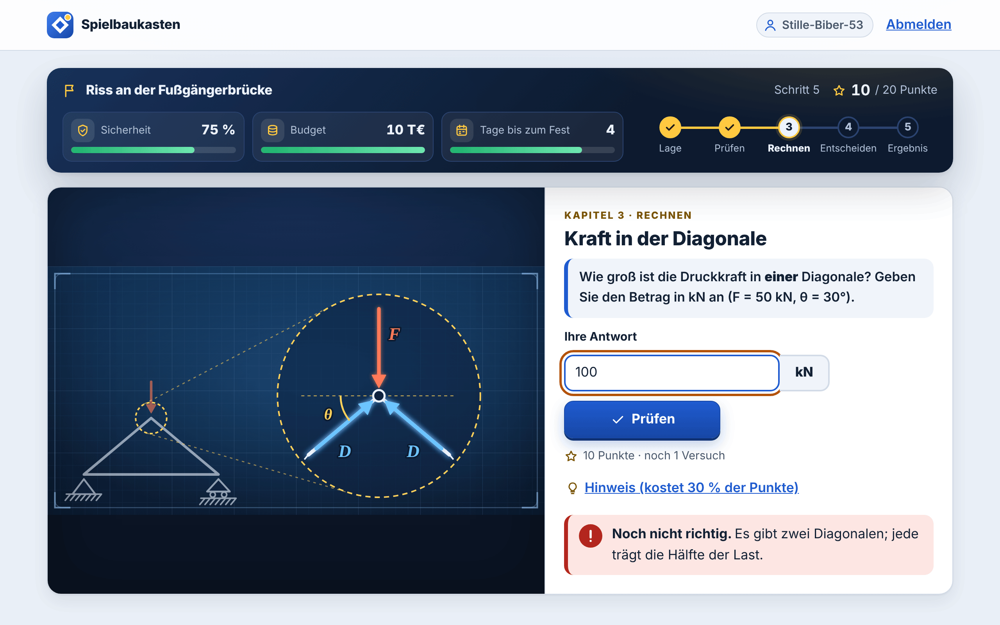
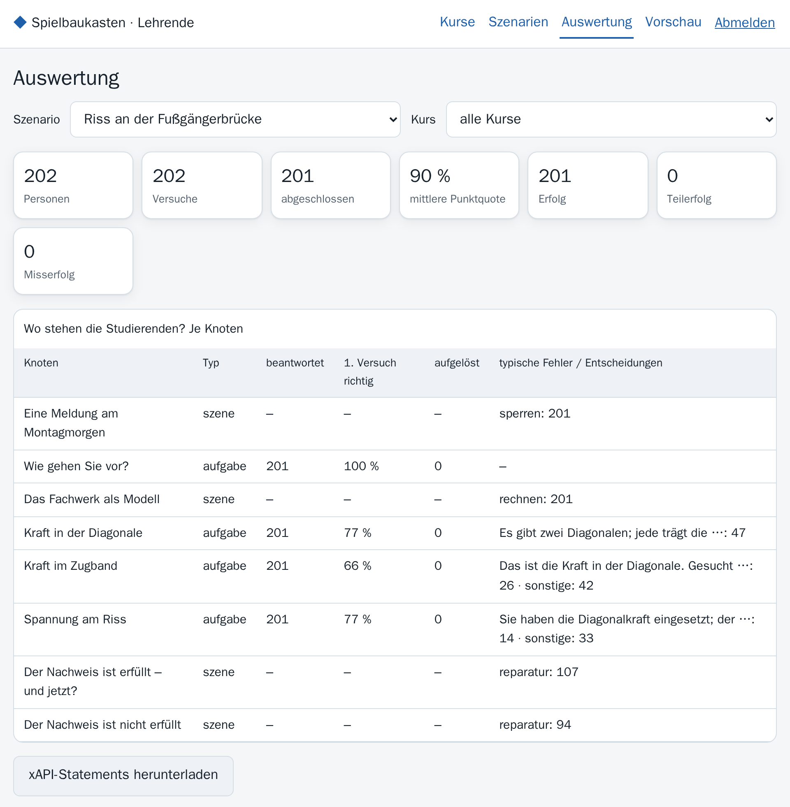
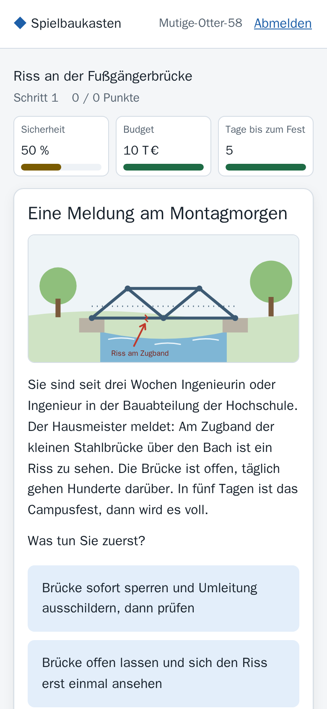

# Spielbaukasten

**Lernspiele für die Ingenieurlehre: Studierende spielen im Browser, Lehrende sehen, wo die Gruppe hängt, und neue
Spiele entstehen als Datei statt als Programm. Das läuft heute – ansehen, selbst ausprobieren, nachprüfen.**



<sub>Rundgang, 89 Sekunden, ohne Ton, mit Untertiteln; aufgenommen am 04.11.2026 an einer laufenden Installation.
[Video herunterladen (MP4, 2,1 MB)](https://github.com/panoherbe/spielbaukasten/raw/main/medien/rundgang.mp4) · Text des Rundgangs weiter unten.</sub>

## Was Sie brauchen → läuft hier schon

| Was Sie brauchen | läuft hier schon |
|---|---|
| Lernspiele im Browser, auf dem Telefon wie am Rechner | zwei Beispielspiele (Technische Mechanik, Elektrotechnik); das Brückenspiel im Chrome auf Rechner- und Telefonbreite durchgespielt (02.11.2026) |
| Rückmeldung, die beim Lernen hilft | typische Fehler werden erkannt und erklärt; zweiter Versuch, Hinweis, Lösung mit Rechenweg |
| Lernfortschritt und Auswertung für Lehrende | Stand je Lernziel; je Aufgabe der Anteil „im ersten Versuch richtig“ und die häufigsten Fehler |
| Datenschutz | keine Namen, keine E-Mail-Adressen, zufällige Pseudonyme; Auswertung nur als Summen ab 3 Personen; Löschen auf Knopfdruck |
| Neue Inhalte ohne Programmierung | Lernspiele sind Dateien; die Prüfung meldet Fehler auf Deutsch mit Fundstelle; jede Version bleibt erhalten |
| Offene Lernressourcen (OER) | Export als eine einzige HTML-Datei (76 KB), läuft ohne Server und ohne Internet: 0 Netzanfragen (02.11.2026); Metadaten nach dem Profil AMB |
| Viele Studierende gleichzeitig | Lasttest mit 300 simulierten Studierenden gleichzeitig, mit Denkzeit: 0 Fehler, 95 % der Antworten unter 0,07 s; 200 simulierte im selben Augenblick: 0 Fehler (02.11.2026) |
| Barrierefreiheit | automatische Prüfung mit axe-core (WCAG 2.0/2.1 A und AA, WCAG 2.2 AA): 0 Verstöße in 9 Ansichten (02.11.2026) |
| Schlank und sicher | erste Seite 11 Dateien, 41 KB, keine Dateien von fremden Servern (02.11.2026); Lösungen und Formeln verlassen den Server nicht |
| Geprüfte Qualität | 32 von 32 automatischen Tests bestanden (02.11.2026) |
| Anschluss an Lernplattformen | xAPI-Ausgabe und eine dokumentierte Schnittstelle (OpenAPI) |
| Offen und übergabefähig | Quellcode unter AGPL-3.0, keine Fremdbibliotheken zur Laufzeit, Dokumentation auf Deutsch |

Jede Zahl steht mit Messweg im [Messprotokoll vom 02.11.2026](nachweis/PROTOKOLL.md) (Version 0.1.0; Rohdaten
`nachweis/messwerte.json`).

## In zwei Minuten selbst prüfen

1. **Ohne Installation spielen:** die [Offline-Fassung](demo/fussgaengerbruecke-v1.html) öffnen, rechts über dem
   Quelltext auf „Download raw file“ (Pfeil nach unten) klicken, die Datei (76 KB) per Doppelklick im Browser öffnen.
   Das Brückenspiel läuft vollständig, ohne Server und ohne Internet; der Fortschritt bleibt auf Ihrem Gerät.
   (Gemessen in Chrome.)
2. **Die ganze Anwendung starten** – mit [Docker Desktop](https://www.docker.com/products/docker-desktop/), drei
   Befehle:
   ```bash
   git clone https://github.com/panoherbe/spielbaukasten.git
   cd spielbaukasten
   docker compose up -d
   ```
   Dann http://localhost:8080 öffnen, Kurscode **DEMO**. Bereich für Lehrende: http://localhost:8080/lehrende,
   Schlüssel **demo-lehrende**.
3. **Nachlesen, was gemessen wurde:** [Messprotokoll](nachweis/PROTOKOLL.md) mit 30 Bildschirmfotos.

## Ihr Vorteil: Sie bewerten ein laufendes System, kein Versprechen

- **Sie sehen vorher, was Sie bekommen.** Oberfläche, Spielablauf, Auswertung und Export lassen sich heute
  anklicken, nicht erst nach Monaten Entwicklung.
- **Die riskanten Teile sind gelöst und gemessen:** viele Nutzer gleichzeitig, Barrierefreiheit, Datenschutz,
  Offline-Export. Das Projekt beginnt nicht bei null.
- **Mehr Projektzeit für das, was zählt:** Ihre Anforderungen, Ihre Inhalte, Tests mit Studierenden und Lehrenden.
  Ein erster testbarer Stand steht früh.
- **Keine Bindung an einen Anbieter:** offener Quellcode (AGPL-3.0), keine Fremdbibliotheken zur Laufzeit,
  Dokumentation auf Deutsch. Das Framework lässt sich ohne mich betreiben und weiterentwickeln.

## So sieht es aus

<table>
<tr>
<td width="50%" valign="top"><br><sub>Rechenaufgabe mit eigenen Zahlen: Ein typischer Fehler wird erkannt und erklärt.</sub></td>
<td width="50%" valign="top"><br><sub>Auswertung für Lehrende: nur Summen, je Aufgabe mit den häufigsten Fehlern. Zahlen aus einem Lasttest mit 200 simulierten Studierenden.</sub></td>
</tr>
<tr>
<td valign="top" align="center"><br><sub>Auf dem Telefon: dasselbe Spiel im Browser, ohne App.</sub></td>
<td valign="top"><br><sub>Neue Spiele sind Dateien: Die Prüfung meldet einen Tippfehler in einer Formel auf Deutsch, mit Fundstelle.</sub></td>
</tr>
</table>

<details>
<summary><b>Text des Rundgangs</b> (die Untertitel des Videos)</summary>

| ab | Untertitel |
|---|---|
| 0:00 | **Titel:** Spielbaukasten – Serious Games für die ingenieurwissenschaftliche Lehre: Studierende spielen im Browser, Lehrende sehen, wo die Gruppe hängt, jedes Spiel lässt sich als offene Lernressource exportieren. |
| 0:04 | Studierende treten mit dem Kurscode ihrer Lehrveranstaltung bei – ohne Konto, ohne Namen. |
| 0:07 | Jede Person spielt unter einem zufälligen Pseudonym. Mit dem persönlichen Code geht es auf einem anderen Gerät weiter. |
| 0:10 | Die Lernspiele des Kurses: hier eins zur Technischen Mechanik, eins zur Elektrotechnik. |
| 0:13 | Ein Entscheidungsspiel: Am Zugband einer Fußgängerbrücke ist ein Riss zu sehen. In fünf Tagen ist Campusfest. Was tun Sie zuerst? |
| 0:17 | Entscheidungen bekommen eine fachliche Rückmeldung und verändern die Lage: Sicherheit, Budget, Tage bis zum Fest. |
| 0:21 | Aufgabe: die Prüfschritte in eine sinnvolle Reihenfolge bringen. |
| 0:24 | Richtig geordnet: Unterlagen, Befund, Rechnung, Nachweis, Entscheidung. |
| 0:27 | Das Fachwerk als Modell. Jede Person bekommt eigene Zahlen für Last und Winkel. |
| 0:30 | Rechenaufgabe mit eigenen Zahlen. Wir antworten absichtlich mit einem typischen Fehler … |
| 0:33 | … und das System erkennt ihn und erklärt: Die Last verteilt sich auf zwei Diagonalen. Dann der zweite Versuch. |
| 0:38 | Richtig – mit Rechenweg zum Nachlesen. |
| 0:40 | Die Aufgaben bauen aufeinander auf: erst die Kraft im Zugband … |
| 0:43 | … dann die Spannung am Riss, nach einem vereinfachten Lehrmodell. |
| 0:48 | Was folgt aus der Rechnung? Wieder eine Entscheidung mit Folgen. |
| 0:53 | Am Ende: Ergebnis, Punkte und der Stand je Lernziel. |
| 0:57 | **Auf dem Telefon:** Dasselbe Spiel im Browser des Telefons wie am Rechner. Keine App, keine Installation, keine Dateien von fremden Servern. |
| 1:00 | Lehrende melden sich mit dem Schlüssel ihrer Installation an. |
| 1:03 | Die Auswertung zeigt, wo die Gruppe hängt: je Aufgabe der Anteil „im ersten Versuch richtig“ und die häufigsten Fehler. (Zahlen: 200 simulierte Studierende aus einem Lasttest und die Durchläufe dieses Rundgangs.) |
| 1:07 | Nur Summen, erst ab drei Personen. Keine Namen, keine E-Mail-Adressen. |
| 1:10 | Neue Lernspiele sind Dateien, keine Programmierung. Hier eine Datei mit einem Tippfehler in einer Formel … |
| 1:12 | … die Prüfung findet ihn und nennt die Stelle, auf Deutsch. Jede hochgeladene Version bleibt erhalten. |
| 1:15 | Jedes Spiel lässt sich als offene Lernressource (OER) exportieren … |
| 1:16 | … als eine einzige HTML-Datei (76 KB). Sie läuft ohne Server und ohne Internet, mit Lizenzhinweis. |
| 1:20 | **Gemessen am 02.11.2026:** 32 von 32 automatischen Tests bestanden · Lasttest mit 300 simulierten Studierenden gleichzeitig, 0 Fehler, 95 % der Antworten unter 0,07 s · Barrierefreiheit automatisch geprüft (WCAG 2.2 AA): 0 Verstöße in 9 Ansichten · erste Seite 41 KB, keine Dateien von fremden Servern. |
| 1:24 | **Selbst prüfen:** die Offline-Fassung herunterladen und im Browser öffnen, oder die ganze Anwendung mit drei Befehlen starten. Quellcode offen, AGPL-3.0. |

</details>

## Ehrlich gesagt: Was der Prototyp noch nicht ist

Ein Prototyp, in wenigen Tagen gebaut, um zu zeigen, dass die Architektur trägt. Kein fertiges Produkt.

| Heute noch nicht enthalten | Was ein Auftrag ergänzen würde |
|---|---|
| Anmeldung über das Single Sign-on einer Hochschule (Shibboleth/SAML, OpenID Connect); heute ein gemeinsamer Schlüssel je Installation | Anbindung an Ihr Anmeldesystem |
| Anbindung an Moodle; vorbereitet sind die xAPI-Ausgabe und die dokumentierte Schnittstelle | Anbindung an Ihre Lernplattform, etwa über LTI 1.3 |
| Grafischer Editor; Spiele werden als Datei geschrieben | Werkzeuge für Autorinnen und Autoren nach Ihren Anforderungen |
| Fachlich geprüfte Inhalte; die Beispiele sind vereinfachte Lehrmodelle, nicht von Fachlehrenden geprüft | Ihre Inhalte und Lernziele, mit Ihren Lehrenden |
| Ihr Erscheinungsbild; die Gestaltung ist bewusst schlicht | Gestaltung nach Ihren Vorgaben |
| Nicht gemessen: echte Geräte, Safari und Firefox, Bildschirmleser, Nutzung durch Studierende, Dauerbetrieb hinter HTTPS | Usability-Tests mit Studierenden und Lehrenden, Erprobung im Semester, Abnahmetest |

## Lizenz

Ab 04.11.2026 AGPL-3.0. Frühere Stände bis Commit [`414f6d6`](https://github.com/panoherbe/spielbaukasten/tree/414f6d6) bleiben unter Apache-2.0. Auftraggeber erhalten im Auftrag die vertraglich vereinbarte Lizenz.

## Kontakt

Panagiotis Herbe · [panoherbe.com](https://panoherbe.com)

---

## Für Ihre IT: Technik im Detail

### Starten

Voraussetzung: [Docker Desktop](https://www.docker.com/products/docker-desktop/) (Windows, macOS) oder Docker unter
Linux.

```bash
git clone https://github.com/panoherbe/spielbaukasten.git
cd spielbaukasten
docker compose up -d
```

| | Adresse | Zugang |
|---|---|---|
| Studierende | http://localhost:8080 | Kurscode **DEMO** |
| Lehrende | http://localhost:8080/lehrende | Schlüssel **demo-lehrende** |

Beenden: `docker compose down` (die Daten bleiben im Volume `daten`; `docker compose down -v` löscht sie).

Ohne Docker, mit [Node.js 24](https://nodejs.org/) oder neuer: `npm start` (es gibt keine Abhängigkeiten zu
installieren). Den Schlüssel für Lehrende zeigt dann die Konsole; den Demokurs gibt es mit
`SBK_DEMO_KURSCODE=DEMO npm start`.

**Was Sie sehen sollten:** Mit dem Kurscode DEMO zwei Lernspiele. „Riss an der Fußgängerbrücke“ (ca. 20 Minuten)
ist ein Entscheidungsspiel zur Technischen Mechanik: sperren oder nicht, Prüfschritte ordnen, Stabkräfte und Spannung
am Riss rechnen (jede Person bekommt eigene Zahlen), dann über die Freigabe entscheiden. „Spannungsteiler am
Sensor“ (ca. 8 Minuten) ist eine kurze Übung. Unter `/lehrende` erscheinen Auswertungen ab drei Personen.

### Funktionen

**Für Studierende**
- Beitritt mit Kurscode, ohne Konto, ohne Namen: Jede Person bekommt ein zufälliges Pseudonym und einen
  persönlichen Code, um auf einem anderen Gerät weiterzumachen.
- Szenen mit Entscheidungen, die Indikatoren verändern (im Beispiel Sicherheit, Budget, Tage); Verzweigungen nach
  Ergebnis.
- Aufgaben in drei Mechaniken: **Rechenaufgabe** mit Einheit und Toleranz (Komma oder Punkt), **Auswahl** (eine oder
  mehrere), **Reihenfolge**. Zahlen je Person verschieden, aus einem Startwert reproduzierbar.
- Rückmeldung zu **typischen Fehlern** (Vorzeichen, Faktor 1000, vom Szenario genannte Fehlerformeln wie „Sinus und
  Kosinus vertauscht“), zweiter Versuch, Hinweis gegen Punktabzug, danach Lösung mit Rechenweg.
- Ende mit Ergebnis, Punkten und dem Stand je Lernziel (sicher, mit Hilfe, noch offen).
- Fortsetzen nach Unterbrechung, auch in einem anderen Tab; eigene Daten herunterladen oder sofort löschen.

**Für Lehrende**
- Kurse anlegen (Kurscode), Szenarien je Kurs freigeben.
- Szenario-Dateien prüfen und hochladen: Fehler kommen als deutsche Meldung mit Fundstelle
  (`knoten.diagonale.loesung: „alpha“ ist kein Parameter des Szenarios`). Jede Version bleibt erhalten; laufende
  Versuche bleiben bei ihrer Version.
- Auswertung je Szenario und Kurs: Versuche, Ergebnisse, je Aufgabe Anteil „im ersten Versuch richtig“ und die
  häufigsten Fehlerarten, je Entscheidung die Verteilung. Nur Summen, und erst ab drei Personen.
- Export als **xAPI-Statements** (für Learning Record Stores) und als **OER-Paket** (eigenständige HTML-Datei plus
  Metadaten nach dem Allgemeinen Metadatenprofil für Bildungsressourcen, AMB). Beispiel: [`demo/`](demo/).

**Technik**
- Node.js 24, **keine Fremdbibliotheken** zur Laufzeit; SQLite aus Node.js (`node:sqlite`). Oberfläche ohne Framework
  und ohne Build-Schritt.
- Dieselbe Spiel-Engine im Browser (Offline-Fassung) und auf dem Server. Online bewertet nur der Server: Er bekommt
  Entscheidungen und Antworten, rechnet den Zustand aus allen Schritten neu aus und schickt nur die aktuelle Ansicht
  zurück. Lösungen und Formeln verlassen den Server nicht.
- Szenarien sind Daten, kein Code: Formeln werden von einem eigenen, abgeschlossenen Rechner ausgewertet, Texte nie als
  HTML eingefügt.
- Schnittstelle beschrieben in [`docs/openapi.json`](docs/openapi.json).

### Aufbau

```
src/engine/      Spiel-Engine: Formeln, Zufall, Mechaniken, Prüfung, Ablauf, Ansicht, xAPI, OER-Metadaten
src/server/      HTTP-Server, Datenbank, Anmeldung, Szenario-Verwaltung
src/web/         Oberfläche für Studierende und Lehrende, Spieler, Darstellung der Mechaniken
src/oer-export.js  Offline-Fassung als eine HTML-Datei
inhalte/szenarien/ die Beispielszenarien (JSON + Bilder)
tools/           pruefe.js (Szenario prüfen), oer-export.js (Export auf der Kommandozeile)
test/            Unit- und Schnittstellentests, Lasttest, Browsertest (CDP)
docs/            Architektur, Inhaltsformat, Erweitern, Datenschutz, Lerndesign, Schnittstelle
nachweis/        Messprotokoll mit Bildschirmfotos
demo/            Offline-Fassung des Brückenspiels mit AMB-Metadaten (erzeugt mit tools/oer-export.js)
medien/          Rundgang (Video, GIF) und Bilder für diese Seite
```

Mehr: [Architektur](docs/ARCHITEKTUR.md) · [Szenarien schreiben](docs/INHALTE.md) ·
[Neue Mechanik ergänzen](docs/ERWEITERN.md) · [Datenschutz](docs/DATENSCHUTZ.md) · [Lerndesign und Evaluation des
Beispielszenarios](docs/LERNDESIGN.md)

### Tests

```bash
docker compose run --rm test                          # 32 Unit- und Schnittstellentests, unter 1 s
node tools/pruefe.js inhalte/szenarien/*/szenario.json  # Szenarien prüfen
```

Die Nachweis-Messung (Lasttest mit 50 und 200 simulierten Personen im selben Augenblick und 300 simulierten mit Denkzeit, Durchspielen im echten
Chrome auf Desktop- und Telefonbreite, Barrierefreiheit mit axe-core, Offline-Fassung):

```bash
docker compose -p spielbaukasten-nachweis -f compose.nachweis.yaml up --build --abort-on-container-exit --exit-code-from messung
docker compose -p spielbaukasten-nachweis -f compose.nachweis.yaml down -v
```

### Einstellungen

| Variable | Bedeutung | Vorgabe |
|---|---|---|
| `SBK_LEHRENDE_SCHLUESSEL` | Schlüssel für die Anmeldung als Lehrende | zufällig je Start (Konsole); im Compose `demo-lehrende` |
| `SBK_DEMO_KURSCODE` | legt beim Start einen Demokurs mit allen Szenarien an | keiner; im Compose `DEMO` |
| `SBK_AUFBEWAHRUNG_TAGE` | danach werden Versuche und Pseudonyme ohne Nutzung gelöscht | 180 |
| `SBK_MIN_GRUPPE` | Auswertungen erst ab so vielen Personen | 3 |
| `SBK_BASIS_URL` | öffentliche Adresse (für xAPI und OER-Metadaten) | `http://localhost:8080` |
| `SBK_SICHERE_COOKIES` | `1` hinter HTTPS | aus |
| `SBK_ZUGRIFFSPROTOKOLL` | `1` schreibt Methode, Pfad, Status, Dauer (keine IP-Adressen) | aus |
| `SBK_DATEN`, `SBK_INHALTE`, `PORT` | Datenverzeichnis, Szenario-Verzeichnis, Port | `./daten`, `./inhalte/szenarien`, 8080 |

### Technische Grenzen

- SQLite genügt für eine Instanz mit einigen hundert gleichzeitigen Personen (gemessen im Lasttest mit simulierten
  Studierenden: 300 mit Denkzeit und 200 im selben Augenblick, siehe Protokoll); für mehr wäre PostgreSQL vorgesehen (Datenzugriff in `src/server/db.js`
  gekapselt).
- Gestaltung über Variablen in `src/web/styles.css` anpassbar.
- Die Fachinhalte der Beispielszenarien sind Lehrbeispiele (vereinfachtes Lehrmodell, kein vollständiger Nachweis
  nach Eurocode 3).

### Rundgang und Bilder

Aufgenommen am 04.11.2026 (nach dem Lizenzwechsel neu) mit Playwright (Chromium) an einer laufenden Installation
dieses Repositorys; 200
simulierte Studierende aus dem Lasttest (`test/last.js`) füllen die Auswertung. Untertitel und Mauszeiger sind in die
Seite gezeichnet, das Video hat keinen Ton. Die Messwerte stammen aus dem Protokoll vom 02.11.2026, nicht aus der
Aufnahme.

Lizenz: AGPL-3.0 für den Code (bis Commit `414f6d6` Apache-2.0), CC BY 4.0 für die beiden Beispielszenarien.
