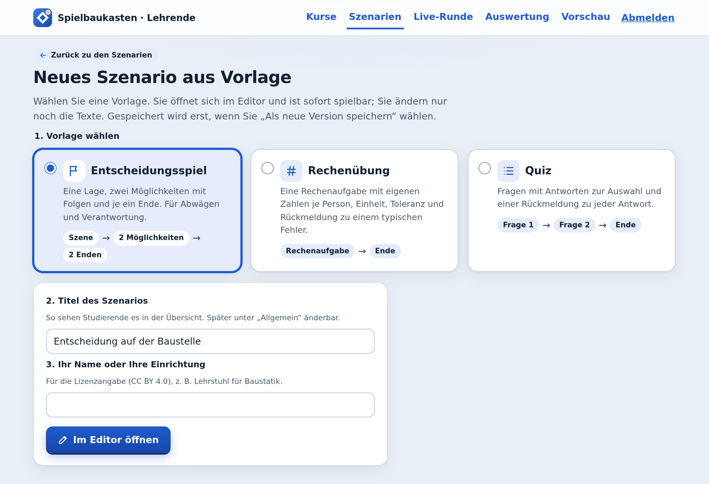
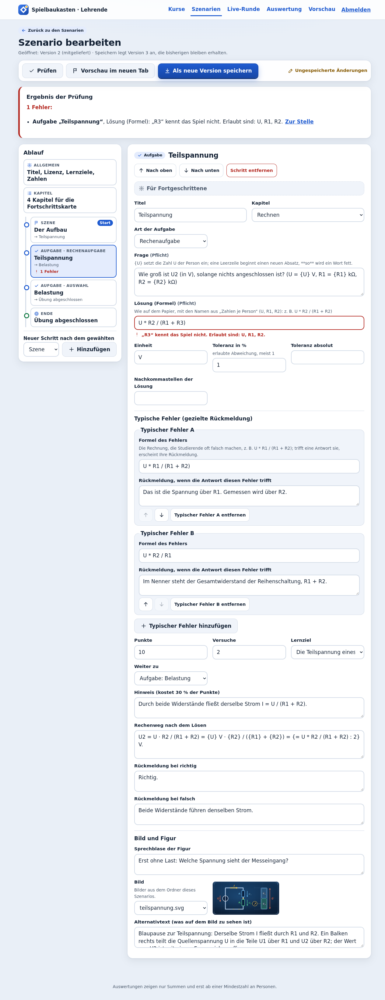
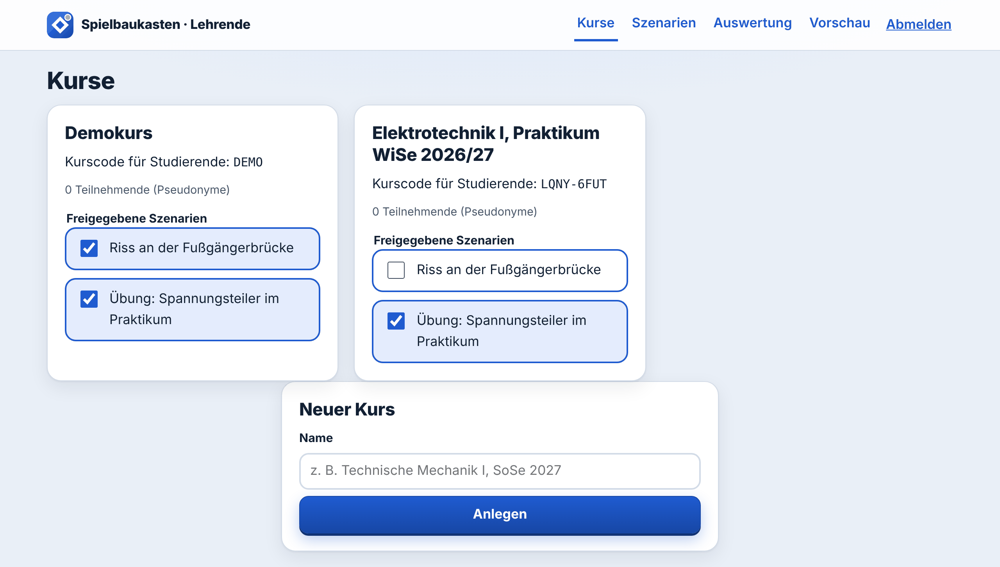
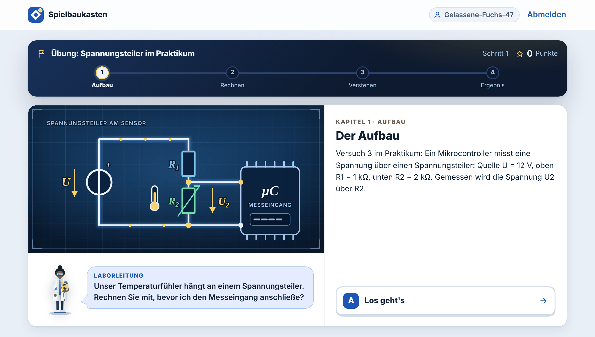
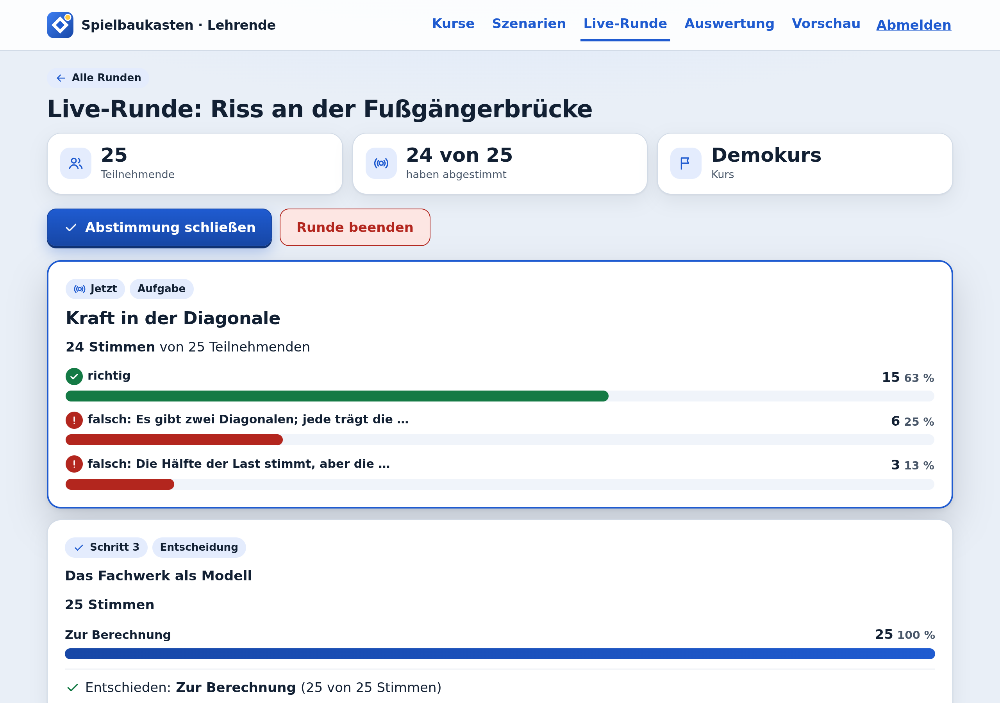

# Eigenes Lernspiel in vier Schritten

Für Lehrende, die ein Lernspiel anpassen oder ein neues anlegen und es ihrem Kurs geben wollen. Programmieren
müssen Sie dafür nicht, und Sie brauchen kein weiteres Programm: Alles geschieht im Browser, im **Szenario-Editor**.
Sie brauchen die Adresse Ihrer Installation und einen Schlüssel für Lehrende. In der Demo-Installation ist das
http://localhost:8080/lehrende mit dem Schlüssel `demo-lehrende`; einen persönlichen Schlüssel vergibt die
Administration.

Zwei Beispiele auf dieser Seite: Ein neues Spiel entsteht aus der Vorlage „Rechenübung“; und aus der „Übung:
Spannungsteiler am Sensor“ wird die „Übung: Spannungsteiler im Praktikum“, freigegeben nur für einen Praktikumskurs.

## 1. Neues Szenario aus Vorlage oder vorhandenes öffnen

Melden Sie sich unter `/lehrende` an und öffnen Sie **Szenarien**.

- **Neues Spiel:** Wählen Sie oben **Neues Szenario aus Vorlage**. Es gibt drei Vorlagen:
  **Entscheidungsspiel** (eine Szene, zwei Möglichkeiten mit Folgen, zwei Enden), **Rechenübung** (eine Rechenaufgabe
  mit eigenen Zahlen je Person, Einheit, Toleranz und Rückmeldung zu einem typischen Fehler) und **Quiz** (zwei Fragen
  mit Antworten zur Auswahl und Rückmeldung zu jeder Antwort). Wählen Sie eine, tragen Sie den Titel und Ihren Namen
  oder Ihre Einrichtung ein (für die Lizenzangabe) und klicken Sie auf **Im Editor öffnen**. Die Vorlage ist sofort
  spielbar: „Prüfen“ meldet keine Fehler, die Vorschau läuft bis zum Ende. Sie ändern nur noch die Texte.
- **Vorhandenes Spiel:** In der Tabelle steht bei jedem Lernspiel **Bearbeiten**.

**Links steht der Ablauf:** „Allgemein“ (Titel, Lizenz, Lernziele, Zahlen je Person), „Kapitel“ und darunter jeder
Schritt des Spiels in seiner Reihenfolge, mit Art (Szene, Aufgabe, Verzweigung, Ende), Titel und den Wegen, die von
ihm weiterführen („→ Geschafft“). **Rechts steht das Formular** des gewählten Teils. Oben rechts steht, ob es
ungespeicherte Änderungen gibt.

## 2. Ändern, was Studierende lesen und entscheiden

Wählen Sie links einen Schritt und ändern Sie rechts die Felder, zum Beispiel unter „Allgemein“ den **Titel** und im
ersten Schritt den **Text der Szene** oder die **Frage**.

| Schritt | Was Sie im Formular einstellen |
|---|---|
| Szene | Text, Sprechblase der Figur; je Möglichkeit: Text, **Führt zu**, Bewertung (gut, vertretbar, riskant), Rückmeldung, Lernziel, Wirkung auf die Spielanzeige (z. B. Sicherheit +20) |
| Aufgabe | Art (**Rechenaufgabe** mit Lösung als Formel, **Einheit** und **Toleranz**; **Auswahl**; **Reihenfolge**), Frage, typische Fehler mit gezielter Rückmeldung, Punkte, Versuche, Hinweis, Rechenweg, Rückmeldung bei richtig und falsch, **Weiter zu** |
| Verzweigung | Regeln „Wenn … dann weiter zu …“ und „Sonst weiter zu“ (unsichtbar für Studierende) |
| Ende | Ergebnis (Erfolg, Teilerfolg, Misserfolg), Text |

- **Neuer Schritt:** unten links Art wählen, **Hinzufügen**. Er erscheint nach dem gewählten Schritt; verbinden Sie
  ihn über „Führt zu“ oder „Weiter zu“ mit dem Ablauf.
- **Reihenfolge und Entfernen:** im Formular **Nach oben**, **Nach unten**, **Schritt entfernen**; Möglichkeiten,
  Antworten und Regeln haben eigene Knöpfe zum Verschieben und Entfernen.
- **Zahlen je Person** (unter „Allgemein“, z. B. `F` von 10 bis 50 in Schritten von 5) setzen Sie in Texte mit
  `{F}` ein, gerechnete Zahlen mit `{= F / 2 : 1}`. Die Lösung einer Rechenaufgabe ist eine Formel mit diesen Namen,
  geschrieben wie auf dem Papier; das Feld zeigt dazu ein Beispiel aus Ihrem Szenario (in der Rechenübung
  `F * 1000 / A`).
- **Für Fortgeschrittene** (zu Beginn geschlossen, mit Maus oder Tastatur zu öffnen): Jeder Schritt hat eine interne
  Kennung, die von selbst aus dem Titel entsteht; Sie brauchen sie nicht. Dort lässt sie sich umbenennen (alle
  Verweise werden angepasst), und dort legen Sie fest, mit welchem Schritt das Spiel beginnt („Als Start
  festlegen“).
- **Bilder:** Für Titelbild und Schritte wählen Sie ein Bild aus dem Ordner des Szenarios und schreiben den
  Alternativtext dazu. Neue Bilder hochladen kann der Editor noch nicht; die legt Ihre IT in den Ordner.

## 3. Prüfen, Vorschau, speichern

- **Prüfen** meldet jeden Fehler in klaren Worten: mit dem Titel des Schritts und dem Namen des Felds, so wie sie im
  Formular stehen. **Zur Stelle** öffnet den Schritt und setzt den Cursor in das Feld, das Feld selbst ist rot
  markiert. Hier ein Tippfehler in einer Formel („R3“ statt „R2“); die Meldung lautet: „Aufgabe „Teilspannung“, Lösung
  (Formel): „R3“ kennt das Spiel nicht. Erlaubt sind: U, R1, R2.“

  

- **Vorschau im neuen Tab** spielt den Entwurf so, wie Studierende ihn sehen, ohne ihn zu speichern. Neu laden
  beginnt von vorn.
- **Als neue Version speichern** legt die nächste Versionsnummer an. Die bisherigen Versionen bleiben erhalten; wer
  gerade spielt, spielt in seiner Version zu Ende, neue Versuche beginnen mit der neuen. Hat inzwischen jemand anderes
  dasselbe Szenario gespeichert, überschreibt der Editor nichts und sagt es Ihnen.

Oben rechts steht immer der Stand: **Keine Änderungen**, **Ungespeicherte Änderungen**, **Noch nicht gespeichert** (neues
Szenario) oder nach dem Speichern **Version … gespeichert**. Verlassen Sie den Editor mit ungespeicherten Änderungen,
fragt er nach.

## 4. Kurs anlegen, freigeben, spielen und auswerten

Öffnen Sie **Kurse**, tragen Sie unter „Neuer Kurs“ einen Namen ein und klicken Sie auf **Anlegen**. Ein neuer Kurs
bekommt zunächst alle Spiele freigegeben. Nehmen Sie die Haken bei den Spielen heraus, die dieser Kurs nicht sehen
soll; jede Änderung wird sofort gespeichert („Freigabe gespeichert.“).

Den **Kurscode** auf der Kurskarte geben Sie an die Studierenden weiter. Sie treten damit auf der Startseite bei,
ohne Konto und ohne Namen, und spielen allein oder **im Team** (ein Team teilt sich einen Spielstand; jede Person
stimmt ab, die Mehrheit entscheidet).

**Wie Studierende es sehen:** die Startseite in einem privaten Browserfenster öffnen und mit dem Kurscode beitreten.
Ihr Testdurchlauf zählt dann als Teilnehmerin oder Teilnehmer; unter „Meine Daten“ können Sie ihn löschen.

**Auswertung:** Unter **Auswertung** wählen Sie Szenario und Kurs. Sie sehen, wie die Versuche ausgehen, welche
Aufgabe im ersten Versuch gelingt, welche typischen Fehler vorkommen und wie entschieden wird. Zahlen erscheinen erst
ab drei Personen (Voreinstellung); vorher steht dort „Noch zu wenige Personen“, damit niemand erkennbar ist.

## In der Vorlesung: Live-Runde

Unter **Live-Runde** wählen Sie Kurs und Szenario und klicken auf **Runde starten**. Die Studierenden des Kurses sehen
die Runde auf ihrer Übersicht und treten mit **Mitmachen** bei. Alle sehen dieselbe Szene und stimmen auf dem eigenen
Gerät ab. Sie sehen live, wie viele abgestimmt haben und, ab drei Stimmen, die Verteilung: bei Entscheidungen je
Möglichkeit mit Bewertung, bei Aufgaben „richtig“ und die erkannten typischen Fehler. Namen oder Pseudonyme sehen Sie
nie.

Stimmen im Bild: alle 25 simuliert, 24 über die Schnittstelle und eine über einen automatisch gesteuerten Browser (Messung vom 12.11.2026).

Mit **Abstimmung schließen** entscheidet die Mehrheit (bei Gleichstand die Möglichkeit, für die zuerst gestimmt
wurde), und alle sehen sofort die Rückmeldung. Haben alle abgestimmt, ist sofort entschieden. **Runde beenden**
beendet sie für alle.

## Fortgeschritten: das Szenario als Datei

Hinter dem Editor steht eine JSON-Datei `szenario.json`; das Format beschreibt [Szenarien schreiben](INHALTE.md).
Im Editor zeigt „Allgemein“ → „Für Fortgeschrittene“ die interne Kennung des Szenarios, den ersten Schritt und die
Datei; **JSON übernehmen** ersetzt den Entwurf, **JSON herunterladen** speichert ihn. Unter **Szenarien** → „Für
Fortgeschrittene: Szenario-Datei prüfen oder hochladen“ laden Sie eine Datei wieder hoch (die Versionsnummer muss dann
höher sein als die geladene); dort nennt die Prüfung die Fundstelle in der Datei (z. B. `knoten.teilspannung.loesung`). Ihre IT kann eine Datei auch ohne Oberfläche prüfen:
`node tools/pruefe.js pfad/zur/szenario.json`.

## Gut zu wissen

- Gespeicherte und hochgeladene Versionen liegen in der Datenbank der Installation, nicht im Repository. Wer die
  Daten der Installation löscht (`docker compose down -v`), löscht sie mit. Laden Sie wichtige Fassungen mit
  **JSON herunterladen** herunter.
- Was die Prüfung als Fehler oder Hinweis meldet, steht in [Szenarien schreiben](INHALTE.md#was-die-prüfung-meldet).

Die Bilder der Vorlagen, des Editors, der Fehlermeldung und der Live-Runde sind am 12.11.2026 mit dem Browsertest
dieses Repositorys entstanden (Chromium, headless, Version 0.2.1); die Bilder zu Kursen und der Sicht der Studierenden
am 09.11.2026 mit Playwright (Chromium, Sprache Deutsch).
