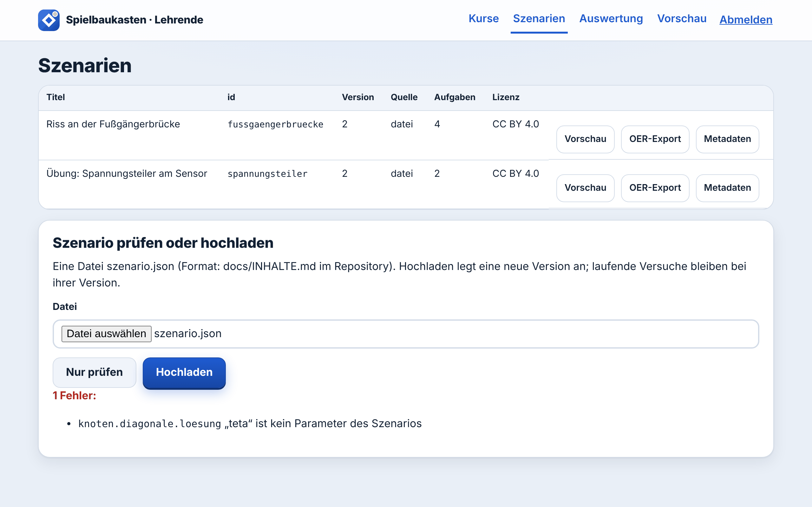
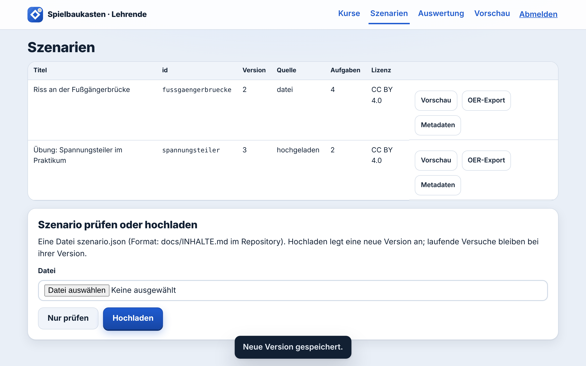

# Eigenes Lernspiel in vier Schritten

Für Lehrende, die ein Lernspiel anpassen oder ein neues anlegen und es ihrem Kurs geben wollen. Programmieren
müssen Sie dafür nicht. Sie brauchen einen Texteditor, die Adresse Ihrer Installation und den Schlüssel für
Lehrende. In der Demo-Installation ist das http://localhost:8080/lehrende mit dem Schlüssel `demo-lehrende`.

Das Beispiel auf dieser Seite: Aus der „Übung: Spannungsteiler am Sensor“ wird die „Übung: Spannungsteiler im
Praktikum“, freigegeben nur für einen Praktikumskurs.

## 1. Vorlage kopieren und Texte ändern

Ein Lernspiel ist eine Datei `szenario.json`. Nehmen Sie eine der beiden mitgelieferten als Vorlage:

- [`inhalte/szenarien/spannungsteiler/szenario.json`](../inhalte/szenarien/spannungsteiler/szenario.json), kurz,
  zwei Aufgaben
- [`inhalte/szenarien/fussgaengerbruecke/szenario.json`](../inhalte/szenarien/fussgaengerbruecke/szenario.json),
  länger, mit Entscheidungen und Indikatoren

Auf GitHub laden Sie die Datei über „Download raw file“ herunter. Öffnen Sie sie in einem Texteditor und ändern Sie,
was Studierende lesen: `titel`, `kurzbeschreibung`, die `text`-Felder der Szenen, Fragen, Hinweise und
Rückmeldungen. Im Beispiel:

```json
"version": 3,
"titel": "Übung: Spannungsteiler im Praktikum",
"kurzbeschreibung": "Vorbereitung auf Versuch 3 im Praktikum: …",
```

und im ersten Knoten `"text": "Versuch 3 im Praktikum: Ein Mikrocontroller misst …"`.

Drei Regeln:

- **`version` erhöhen.** Jede hochgeladene Version muss eine höhere Nummer haben als die geladene. Die alte Version
  bleibt erhalten.
- **`id` behalten, wenn Sie ein vorhandenes Spiel anpassen.** Dann bleiben Szenenbilder und Spielfigur erhalten,
  denn Bilder liegen im Ordner des Spiels auf dem Server.
- **Neue `id` für ein neues Spiel.** Hochladen geht auch dann, aber nur die Datei, keine Bilder. Entfernen Sie in
  diesem Fall die Felder `titelbild`, `figur` und `bild`, oder lassen Sie den Ordner
  `inhalte/szenarien/<id>/` mit den Bildern von Ihrer IT auf dem Server anlegen.

Platzhalter wie `{U}` oder `{= U * R2 / (R1 + R2) : 2}` setzen Zahlen ein. Alle Felder, Formeln und Mechaniken
beschreibt [Szenarien schreiben](INHALTE.md).

## 2. Prüfen und hochladen

Melden Sie sich unter `/lehrende` an und öffnen Sie **Szenarien**. Unter „Szenario prüfen oder hochladen“ wählen Sie
die Datei aus und klicken zuerst auf **Nur prüfen**. Die Prüfung meldet jeden Fehler auf Deutsch, mit der Stelle in
der Datei. Hier ein Tippfehler in einer Formel:



Korrigieren Sie die Stelle im Editor, wählen Sie die Datei erneut aus und prüfen Sie noch einmal. Steht dort
„✓ Keine Fehler.“, klicken Sie auf **Hochladen**. Die neue Version erscheint in der Tabelle, mit der Quelle
„hochgeladen“:



Wer gerade spielt, spielt in seiner bisherigen Version zu Ende. Neue Versuche beginnen mit der neuen Version.

## 3. Kurs anlegen und Spiel freigeben

Öffnen Sie **Kurse**, tragen Sie unter „Neuer Kurs“ einen Namen ein und klicken Sie auf **Anlegen**. Ein neuer Kurs
bekommt zunächst alle Spiele freigegeben. Nehmen Sie die Haken bei den Spielen heraus, die dieser Kurs nicht sehen
soll; jede Änderung wird sofort gespeichert („Freigabe gespeichert.“).


Den **Kurscode** auf der Kurskarte geben Sie an die Studierenden weiter, etwa im Kursraum Ihrer Lernplattform. Sie
treten damit auf der Startseite bei, ohne Konto und ohne Namen.

## 4. Ausprobieren und auswerten

**Vorschau:** Öffnen Sie die Startseite in einem privaten Browserfenster und treten Sie mit dem Kurscode bei. Sie
sehen genau die Spiele, die der Kurs freigegeben hat, und spielen sie wie Studierende:


Ihr Testdurchlauf zählt als Teilnehmerin oder Teilnehmer des Kurses. Unter „Meine Daten“ unten auf der Seite können
Sie ihn danach löschen.

Der Link **Vorschau** im Bereich für Lehrende zeigt dagegen alle Spiele der Installation, nicht nur die des
Kurses.

**Auswertung:** Unter **Auswertung** wählen Sie Szenario und Kurs. Sie sehen, wie die Versuche ausgehen, welche Aufgabe
im ersten Versuch gelingt, welche typischen Fehler vorkommen und wie entschieden wird. Zahlen erscheinen erst ab drei
Personen (Voreinstellung); vorher steht dort „Noch zu wenige Personen“, damit niemand erkennbar ist. Wie eine gefüllte Auswertung
aussieht, zeigt das [Bild in der README](../medien/bild-auswertung.png).

## Gut zu wissen

- Hochgeladene Versionen liegen in der Datenbank der Installation, nicht im Repository. Wer die Daten der
  Installation löscht (`docker compose down -v`), löscht sie mit. Bewahren Sie Ihre `szenario.json` deshalb auf.
- Ihre IT kann eine Datei auch ohne Oberfläche prüfen: `node tools/pruefe.js pfad/zur/szenario.json`.
- Was die Prüfung als Fehler oder Hinweis meldet, steht in [Szenarien schreiben](INHALTE.md#was-die-prüfung-meldet).

Die Bilder auf dieser Seite sind am 09.11.2026 mit Playwright (Chromium, Sprache Deutsch) an einer laufenden
Installation dieses Repositorys entstanden.
